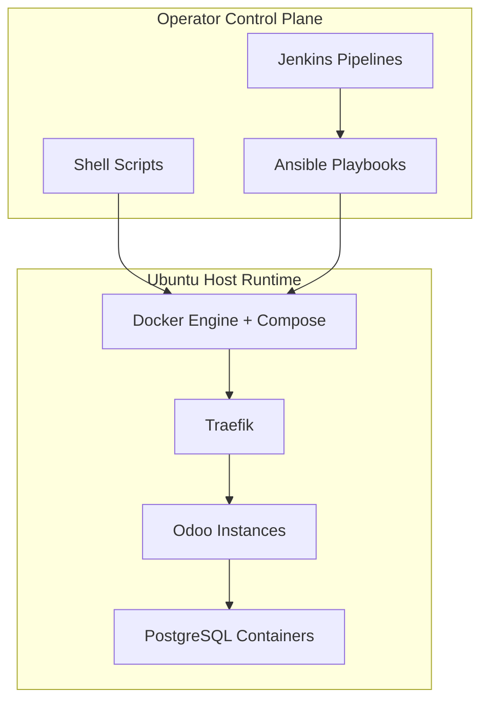
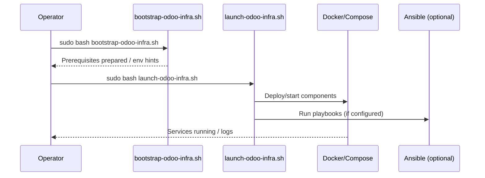

# Operating Methods - Odoo Multi-Version Deployment (Ubuntu Target)

## 1. Document Overview

| Field | Value |
|---|---|
| Target platform | Linux Ubuntu Server (20.04 / 22.04 / 24.04 LTS guidance) |
| Scope | Practical execution methods for bootstrap, install, backup, restore, and health checks |
| Primary location (deployment variant) | `/opt/Odoo-MultiVersion-Deployment/scripts/` on Ubuntu (paths may differ per installation) |
| Note | This repository may be edited on Windows; execution is intended on Ubuntu hosts |

## 2. Quick Information Table

| Method | Use Case | Entry Point |
|---|---|---|
| One-command launch | Fast bootstrap + launch | `sudo bash launch-odoo-infra.sh` |
| Step-by-step | Controlled setup | `bootstrap-odoo-infra.sh` then `launch-odoo-infra.sh` |
| Per-component scripts | Targeted install/ops | `install-odoo17.sh`, `install-odoo19.sh`, etc. |
| Jenkins | CI/CD-driven operations | `Jenkins/*.Jenkinsfile` (variant-specific) |
| Ansible direct | Playbook-driven operations | `ansible-playbook ...` (inventory/vars required) |

## 3. Table of Contents

1. [Document Overview](#1-document-overview)
2. [Quick Information Table](#2-quick-information-table)
3. [Table of Contents](#3-table-of-contents)
4. [Architecture Diagram](#4-architecture-diagram)
5. [Prerequisites Table](#5-prerequisites-table)
6. [Required Ports Table](#6-required-ports-table)
7. [Installation Workflow](#7-installation-workflow)
8. [Step-by-Step Installation](#8-step-by-step-installation)
9. [Configuration Files](#9-configuration-files)
10. [Directory Structure](#10-directory-structure)
11. [Service Management Commands](#11-service-management-commands)
12. [Verification Commands](#12-verification-commands)
13. [Troubleshooting Table](#13-troubleshooting-table)
14. [Backup and Restore Commands](#14-backup-and-restore-commands)
15. [Security Checklist](#15-security-checklist)
16. [Official References](#16-official-references)

## 4. Architecture Diagram



## 5. Prerequisites Table

| No. | Component | Minimum | Recommended | Verification |
|---:|---|---|---|---|
| 1 | Ubuntu Server | 20.04 LTS | 22.04 / 24.04 LTS | `lsb_release -a` |
| 2 | CPU | 2 cores | 4+ cores | `nproc` |
| 3 | RAM | 4 GB | 8+ GB | `free -h` |
| 4 | Storage | 100 GB | 500+ GB SSD | `df -h` |
| 5 | Docker Engine | 20.10+ | latest stable | `docker --version` |
| 6 | Docker Compose | v2 | latest stable | `docker compose version` |
| 7 | Ansible | core + collections (as needed) | latest stable | `ansible --version` |
| 8 | Python 3 | 3.8+ | latest stable | `python3 --version` |
| 9 | Git | 2.x | latest stable | `git --version` |

## 6. Required Ports Table

| Port | Protocol | Purpose | Exposure |
|---:|---|---|---|
| 80 | TCP | HTTP entry (Traefik/redirect) | Public as designed |
| 443 | TCP | HTTPS entry | Public as designed |
| 8069 | TCP | Odoo HTTP (internal/routed) | Internal/proxy |
| 8072 | TCP | Odoo longpolling (internal/routed) | Internal/proxy |
| 5432 | TCP | PostgreSQL | Internal only |

## 7. Installation Workflow



## 8. Step-by-Step Installation

### 8.1 Navigate to Scripts Directory

**Purpose:** Run deployment scripts from the expected working directory.

**Commands:**

```bash
cd /opt/Odoo-MultiVersion-Deployment/scripts
```

**Verification:**

```bash
pwd
ls
```

**Expected Result:** Script files such as `bootstrap-odoo-infra.sh` and `launch-odoo-infra.sh` are listed.

### 8.2 Run One-Command Launch

**Purpose:** Bootstrap dependencies and launch the deployment flow.

**Commands:**

```bash
sudo bash launch-odoo-infra.sh
```

**Verification:**

```bash
docker ps
```

**Expected Result:** Required containers/services start according to the selected workflow.

### 8.3 Run Step-by-Step Bootstrap and Launch

**Purpose:** Separate prerequisite installation from deployment.

**Commands:**

```bash
sudo bash bootstrap-odoo-infra.sh
sudo bash launch-odoo-infra.sh
```

**Verification:**

```bash
systemctl is-active docker 2>/dev/null || docker info
```

**Expected Result:** Docker and prerequisites are ready; launch completes or reports actionable errors.

### 8.4 Install Specific Odoo Versions (Script Variant)

**Purpose:** Deploy a targeted Odoo version stack when scripts exist in the variant.

**Commands:**

```bash
sudo bash install-odoo17.sh
sudo bash install-odoo19.sh
```

**Verification:**

```bash
docker ps --format 'table {{.Names}}\t{{.Status}}'
```

**Expected Result:** Target Odoo/PostgreSQL containers are running.

### 8.5 Run Health Checks

**Purpose:** Validate service responsiveness.

**Commands:**

```bash
sudo bash health-check.sh instance1 8069 8072
sudo bash health-check.sh instance2 8069 8072
```

**Verification:**

```bash
echo $?
```

**Expected Result:** Health script returns success for healthy instances.

### 8.6 Execute Jenkins Pipelines

**Purpose:** Run standardized CI/CD operations.

**Commands:**

```text
Jenkins UI -> Select pipeline -> Build with parameters (if any)
```

**Verification:**

```text
Pipeline stages complete successfully; console log shows no fatal errors.
```

**Expected Result:** Install/backup/restore/verify jobs complete as configured.

### 8.7 Execute Ansible Playbooks Directly

**Purpose:** Apply infrastructure changes without Jenkins.

**Commands:**

```bash
cd /opt/Odoo-MultiVersion-Deployment
ansible-playbook -i ansible/inventory/hosts.ini -e @versions/odoo17.yml ansible/playbooks/install-odoo17.yml
ansible-playbook -i ansible/inventory/hosts.ini -e @versions/odoo19.yml ansible/playbooks/install-odoo19.yml
ansible-playbook -i ansible/inventory/hosts.ini ansible/playbooks/backup.yml
ansible-playbook -i ansible/inventory/hosts.ini ansible/playbooks/verify.yml
```

**Verification:**

```bash
ansible-playbook --syntax-check -i ansible/inventory/hosts.ini ansible/playbooks/install-odoo17.yml
```

**Expected Result:** Playbooks run with no failed tasks (syntax check passes before execution).

## 9. Configuration Files

| File / Pattern | Purpose | Notes |
|---|---|---|
| `.env` | Secrets and environment variables | Restrict permissions; never commit |
| `versions/*.yml` | Version/instance parameters (variant-specific) | Validate domains, images, paths |
| `ansible/inventory/hosts.ini` | Target hosts | Confirm SSH/user/become settings |
| `ansible/group_vars/*.yml` | Shared variables | Review sensitive values handling |
| `Jenkins/*.Jenkinsfile` | Pipeline definitions | Match credentials and agent labels |

## 10. Directory Structure

| Path (typical on Ubuntu variant) | Description |
|---|---|
| `/opt/Odoo-MultiVersion-Deployment/` | Project/deployment root (variant-specific) |
| `/opt/odoo17/`, `/opt/odoo18/`, `/opt/odoo19/` | Per-version configuration/runtime dirs (if used) |
| `/data/odoo*/` | Persistent data/filestore/DB volumes (if used) |
| `/data/backups/` | Backup artifacts (if used) |
| `/var/log/odoo-bootstrap.log` | Bootstrap log (if created by scripts) |

> [!NOTE]
> Actual paths depend on the deployment bundle you execute. Confirm paths in scripts, compose files, and variables before running destructive operations.

## 11. Service Management Commands

| Task | Command | Verification |
|---|---|---|
| List containers | `docker ps -a` | Expected containers present |
| Inspect service logs | `docker logs <name> --tail 200` | Errors/warnings identified |
| Restart a container | `docker restart <name>` | Container returns to `Up` |
| Validate compose config | `docker compose -f <file> config` | Rendered config prints without errors |

## 12. Verification Commands

| Check | Command | Expected Result |
|---|---|---|
| Docker daemon | `docker info` | Server info returned |
| Network (proxy) | `docker network ls` | Proxy/external network exists if required |
| Odoo HTTP probe | `curl -fsS -o /dev/null -w "%{http_code}\n" http://localhost:8069/web/login` | HTTP code returned (e.g., 200/303 depending on state) |
| PostgreSQL readiness | `docker exec <db> pg_isready -U <user> -d <db>` | `accepting connections` |

## 13. Troubleshooting Table

| No. | Problem | Possible Cause | Solution | Verification |
|---:|---|---|---|---|
| 01 | `permission denied` on scripts | Not executable or missing sudo | `chmod +x *.sh` and/or run with `sudo` | Script executes |
| 02 | Docker daemon unavailable | Service stopped | `sudo systemctl start docker` | `docker info` |
| 03 | Ansible host unreachable | Inventory/SSH misconfig | Fix `hosts.ini`, keys, user, `become` | `ansible all -m ping -i ...` |
| 04 | TLS/cert issuance fails | DNS/port 80 challenge blocked | Open ports, verify DNS A/AAAA records | Traefik/ACME logs |
| 05 | Container restart loop | Bad env/config/image | Inspect logs and env; validate compose | `docker logs <name>` |

## 14. Backup and Restore Commands

| Operation | Command (examples) | Verification |
|---|---|---|
| Backup instance (script variant) | `sudo bash backup.sh instance1 /data/backups/odoo17` | Archive created |
| Restore DB (automation script) | `bash automation/scripts/restore-db.sh <ver> <dump.sql.gz> <db> --force` | DB healthy; app accessible |
| Restore (deployment variant) | `sudo bash restore.sh <backup_id> <version> <instance> existing` | Services restored; data checks pass |
| Verify backups | `sudo bash verify-backups.sh /data/backups` | Integrity checks pass |

## 15. Security Checklist

| No. | Control | Verification |
|---:|---|---|
| 01 | Run scripts only from trusted sources; review before `sudo` | Code review / checksum policy |
| 02 | Protect `.env` and credentials | `chmod 600 .env` |
| 03 | Keep PostgreSQL internal | No public `5432` binding |
| 04 | Protect Traefik dashboard and admin endpoints | Auth + network controls |
| 05 | Test restores regularly | Documented restore drills |

## 16. Official References

| Resource | URL |
|---|---|
| Ubuntu Server Documentation | https://ubuntu.com/server/docs |
| Docker | https://docs.docker.com/ |
| Ansible | https://docs.ansible.com/ |
| Jenkins | https://www.jenkins.io/doc/ |
| Traefik | https://doc.traefik.io/traefik/ |
| PostgreSQL | https://www.postgresql.org/docs/ |

---
*Paths and script names vary by deployment bundle; confirm against the variant you operate.*