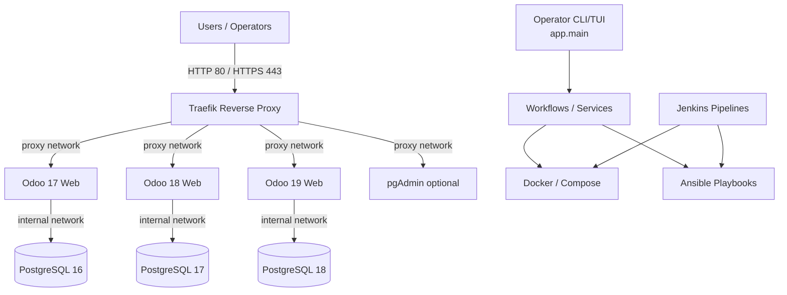
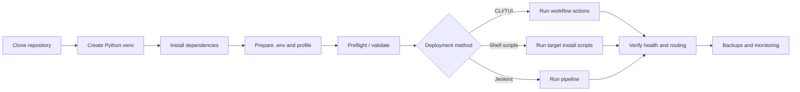

# Odoo Infrastructure Manager - Technical Documentation

## 1. Document Overview

| Field | Value |
|---|---|
| Project | Odoo Infrastructure Manager (`Infrastructure-manage-T`) |
| Purpose | Multi-version Odoo deployment and operations on Ubuntu with Docker, Traefik, PostgreSQL, Ansible, and Jenkins assets |
| Supported OS (deployment target) | Ubuntu Server 22.04 LTS / 24.04 LTS (repository documentation and scripts target Linux) |
| Supported Odoo stacks (repository assets) | Odoo 17 + PostgreSQL 16, Odoo 18 + PostgreSQL 17, Odoo 19 + PostgreSQL 18 (see deployment folders and templates) |
| Primary interfaces | Python CLI/TUI (`app/main.py`, `launch-odoo-infra.sh`), shell scripts, Ansible playbooks, Jenkins pipelines |
| Repository version marker | `1.0.0` (per prior release notes) |
| Validation status | Production readiness requires verification on a real Ubuntu host with Docker/Ansible/Jenkins runtimes (current workspace may be edited on Windows) |

**Scope note:** This document describes repository capabilities and practical workflows. Exact domains, ports, passwords, and paths must come from your `.env`, profiles, and deployment assets; do not copy placeholder values into production without review.

## 2. Quick Information Table

| Item | Details |
|---|---|
| CLI entry | `python3 app/main.py` |
| Launcher | `./launch-odoo-infra.sh` |
| Bootstrap | `sudo ./bootstrap-odoo-infra.sh [--install-docker] [--with-ansible]` |
| Profile (default) | `profiles/example.yaml` (`--profile` to override) |
| Key actions | `tui`, `textual`, `preflight`, `validate`, `prep`, `traefik`, `odoo17`, `odoo18`, `odoo19`, `full`, `health`, `server-setup`, `sequential-install`, `final-workflow`, `inspect`, `install-report` |
| Templates | `templates/` (`.env.template`, compose/Jinja templates) |
| Automation | `automation/scripts/`, `automation/ansible/` |
| Deployment assets | `deployment/` (Traefik, Odoo 17/18/19, pgAdmin, Portainer, Ansible/Jenkins variants) |
| Tests | `python3 -m unittest discover tests -v` (unit/mocked in non-Ubuntu environments) |

## 3. Table of Contents

1. [Document Overview](#1-document-overview)
2. [Quick Information Table](#2-quick-information-table)
3. [Table of Contents](#3-table-of-contents)
4. [Architecture Diagram](#4-architecture-diagram)
5. [Prerequisites Table](#5-prerequisites-table)
6. [Required Ports Table](#6-required-ports-table)
7. [Installation Workflow](#7-installation-workflow)
8. [Step-by-Step Installation](#8-step-by-step-installation)
9. [Configuration Files](#9-configuration-files)
10. [Directory Structure](#10-directory-structure)
11. [Service Management Commands](#11-service-management-commands)
12. [Verification Commands](#12-verification-commands)
13. [Troubleshooting Table](#13-troubleshooting-table)
14. [Backup and Restore Commands](#14-backup-and-restore-commands)
15. [Security Checklist](#15-security-checklist)
16. [Official References](#16-official-references)

## 4. Architecture Diagram



**Notes:** Exact container names, networks, volumes, and host ports depend on the selected deployment variant under `deployment/` and generated compose/config files.

## 5. Prerequisites Table

| Requirement | Minimum (guidance) | Recommended (guidance) | Verification |
|---|---:|---:|---|
| Ubuntu Server | 22.04 LTS | 24.04 LTS | `lsb_release -a` |
| Python | 3.10+ | 3.12+ | `python3 --version` |
| Docker Engine | 20.10+ | 24.0+ | `docker --version` |
| Docker Compose | v2 | v2.20+ | `docker compose version` |
| Ansible (if used) | 2.12+ | 2.16+ | `ansible --version` |
| Git | 2.x | latest stable | `git --version` |
| RAM / Disk | 4 GB / 50 GB | 8+ GB / 100+ GB | `free -h`, `df -h` |

> [!IMPORTANT]
> Run installation and deployment commands on the target Ubuntu host with appropriate privileges (`sudo` where required). Review scripts before execution.

## 6. Required Ports Table

| Port | Protocol | Purpose | Exposure |
|---:|---|---|---|
| 80 | TCP | HTTP (typically redirected to HTTPS by Traefik) | Public (as designed) |
| 443 | TCP | HTTPS | Public (as designed) |
| 8069 | TCP | Odoo HTTP (container internal / routed) | Internal / via proxy |
| 8072 | TCP | Odoo longpolling/live chat (container internal / routed) | Internal / via proxy |
| 5432 | TCP | PostgreSQL | **Internal only** (never expose publicly) |
| 5050 (example) | TCP | pgAdmin (if enabled; value may vary) | Controlled / via proxy per config |

> [!WARNING]
> Do not publish PostgreSQL to `0.0.0.0` in production. Confirm actual host bindings in your compose files.

## 7. Installation Workflow



## 8. Step-by-Step Installation

### 8.1 Clone Repository and Enter Project Directory

**Purpose:** Obtain source code and operate from the project root.

**Commands:**

```bash
git clone <REPOSITORY_URL>
cd Infrastructure-manage-T
```

**Verification:**

```bash
pwd
ls
```

**Expected Result:** Project files such as `app/`, `automation/`, `deployment/`, and `README.md` are present.

### 8.2 Create Python Virtual Environment

**Purpose:** Isolate Python dependencies for the manager CLI/TUI.

**Commands:**

```bash
python3 -m venv venv
source venv/bin/activate
```

**Verification:**

```bash
python3 --version
which python3
```

**Expected Result:** Virtual environment is active and Python is available.

### 8.3 Install Project Dependencies

**Purpose:** Install the package and runtime requirements.

**Commands:**

```bash
pip install -e .
```

**Verification:**

```bash
python3 app/main.py --help
```

**Expected Result:** CLI help renders without import/build errors.

### 8.4 Prepare Environment and Secrets File

**Purpose:** Provide configuration and credentials through environment files (not committed to Git).

**Commands:**

```bash
# Recommended bootstrap path (installs prerequisites and can generate .env)
sudo ./bootstrap-odoo-infra.sh --install-docker --with-ansible

# Manual alternative
cp templates/env.template .env
chmod 600 .env
nano .env
```

**Verification:**

```bash
test -f .env && stat -c "%a %n" .env
```

**Expected Result:** `.env` exists with restrictive permissions (for example `600`).

### 8.5 Run Preflight and Validation

**Purpose:** Detect configuration and environment issues before deployment.

**Commands:**

```bash
python3 app/main.py --action preflight
python3 app/main.py --action validate
```

**Verification:**

```bash
python3 app/main.py --action inspect
```

**Expected Result:** Reports identify missing prerequisites or configuration conflicts to resolve.

### 8.6 Launch Interactive or Direct Workflows

**Purpose:** Execute deployment/operations through supported interfaces.

**Commands:**

```bash
# Interactive menu
./launch-odoo-infra.sh

# Textual UI
./launch-odoo-infra.sh --action textual

# Direct actions (examples)
python3 app/main.py --action traefik
python3 app/main.py --action odoo17
python3 app/main.py --action full
```

**Verification:**

```bash
python3 app/main.py --action health
```

**Expected Result:** Selected workflow completes or reports actionable failures; health checks summarize component status.

## 9. Configuration Files

| File / Location | Purpose | Notes |
|---|---|---|
| `.env` (root, generated) | Runtime secrets and environment variables | Keep permissions `600`; never commit real secrets |
| `templates/env.template` | Template for `.env` | Copy and customize |
| `profiles/*.yaml` | Reusable deployment profiles | Select with `--profile` |
| `deployment/*/docker-compose*.yml` / `.j2` | Compose definitions per component | Review networks, volumes, ports |
| `automation/ansible/*` | Playbooks, roles, inventory | Use for automated provisioning/deployment |
| `templates/*.j2` | Jinja templates for generated configs | Validate rendered output before production |

## 10. Directory Structure

| Path | Description |
|---|---|
| `app/` | Python application (CLI, UI, services, workflows, validators, models) |
| `automation/` | Shell automation and Ansible assets |
| `deployment/` | Component-specific deployment bundles (Traefik, Odoo, pgAdmin, Portainer, Jenkins/Ansible variants) |
| `docs/` | Architecture, security, disaster recovery, audits, and reports |
| `profiles/` | YAML profiles |
| `templates/` | Environment and compose/config templates |
| `tests/` | Unit/integration-style test modules (many mocked) |
| `bootstrap-odoo-infra.sh` | Bootstrap script (Ubuntu target) |
| `launch-odoo-infra.sh` | Launcher script |
| `pyproject.toml` | Python project metadata/dependencies |

## 11. Service Management Commands

| Task | Command (examples) | Verification |
|---|---|---|
| Check container status | `docker ps` | Containers show `Up` / healthy as expected |
| Tail logs | `docker logs <container_name> --tail 100` | Logs show startup or error details |
| Compose up (path-specific) | `docker compose -f <compose_file> up -d` | Services start without errors |
| Compose down (safe) | `docker compose -f <compose_file> down` | Services stop; volumes preserved unless explicitly removed |
| Traefik audit (CLI) | `python3 app/main.py --action traefik-audit` | Reports ports/network/dashboard status |
| Health check (CLI) | `python3 app/main.py --action health` | Exit code and output indicate component health |

> [!CAUTION]
> Avoid destructive commands (for example `docker compose down -v`) unless you have verified backups and explicit approval.

## 12. Verification Commands

| Check | Command | Expected Result |
|---|---|---|
| Python CLI | `python3 app/main.py --help` | Help output, exit code 0 |
| Docker engine | `docker info` | Daemon reachable (on target host) |
| Compose | `docker compose version` | Compose v2 reported |
| Proxy network (if used) | `docker network ls` | Expected external network present (name per deployment) |
| HTTP endpoint (local/routed) | `curl -I http://localhost:<port>/` or routed URL | HTTP response received (code depends on app state) |
| PostgreSQL readiness (inside container) | `docker exec <db_container> pg_isready -U <user> -d <db>` | `accepting connections` |

## 13. Troubleshooting Table

| No. | Problem | Possible Cause | Solution | Verification |
|---:|---|---|---|---|
| 01 | CLI fails to start | Missing venv/deps or wrong Python | Recreate venv; `pip install -e .` | `python3 app/main.py --help` |
| 02 | Docker commands fail | Daemon not running or permission denied | Start Docker; add user to `docker` group or use `sudo` | `docker info` |
| 03 | Port conflict | Another service bound to 80/443/ports | Identify process; adjust bindings/proxy config | `ss -tulpn \| grep :443` |
| 04 | Odoo not reachable via domain | DNS/TLS/routing misconfiguration | Verify DNS, Traefik routers, cert resolver, labels | `curl -Ik https://<domain>` |
| 05 | Database connection errors | Wrong credentials/network/DB not ready | Check `.env`, internal network, DB health | `pg_isready` inside DB container |
| 06 | Restore/backup script issues | Wrong paths, permissions, or container names | Review script args and manifests; run with correct privileges | Script logs + checksums |

## 14. Backup and Restore Commands

| Operation | Command (examples; adjust to your deployment) | Verification |
|---|---|---|
| DB backup (automation script) | `bash automation/scripts/backup-db.sh <version> <db_name> <retention>` | Backup files created; checksums/metadata present |
| DB restore (automation script) | `bash automation/scripts/restore-db.sh <version> <dump_file.sql.gz> <db_name> --force` | DB accepts connections; application login works |
| Deployment-specific backup | `bash deployment/<...>/scripts/backup.sh <args>` | Archive exists in backup directory |
| Deployment-specific restore | `bash deployment/<...>/scripts/restore.sh <args>` | Services restart cleanly; data validated |

> [!IMPORTANT]
> Backup/restore procedures vary across `automation/` and `deployment/` variants. Treat script arguments and manifest formats as authoritative for the chosen variant; test restores in a non-production environment first.

## 15. Security Checklist

| No. | Control | Status Guidance | Verification |
|---:|---|---|---|
| 01 | `.env` permissions restricted | Required | `stat -c "%a %n" .env` |
| 02 | No secrets committed to Git | Required | Review `git status`, history policies |
| 03 | PostgreSQL not publicly exposed | Required | Inspect compose port bindings / firewall |
| 04 | TLS enabled for public endpoints | Recommended | `curl -Ik https://<domain>` |
| 05 | Traefik dashboard protected | Recommended | Auth middleware / access controls |
| 06 | Least privilege on containers | Recommended | `no-new-privileges`, read-only mounts where possible |
| 07 | Backups encrypted/stored securely | Recommended | Storage policy + access audit |
| 08 | Tested restore procedure | Required | Documented restore drill results |

## 16. Official References

| Resource | URL |
|---|---|
| Odoo Documentation | https://www.odoo.com/documentation/ |
| Docker Documentation | https://docs.docker.com/ |
| Docker Compose | https://docs.docker.com/compose/ |
| Traefik Documentation | https://doc.traefik.io/traefik/ |
| PostgreSQL Documentation | https://www.postgresql.org/docs/ |
| Ansible Documentation | https://docs.ansible.com/ |
| Jenkins Documentation | https://www.jenkins.io/doc/ |
| Let’s Encrypt | https://letsencrypt.org/docs/ |

---
*This document follows a practical-first documentation style. Validate all commands and paths against your target environment and selected deployment variant before production use.*
