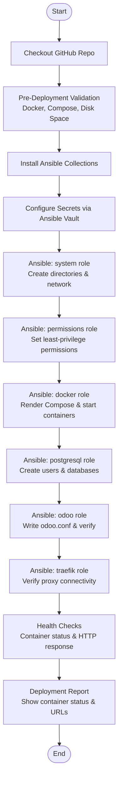
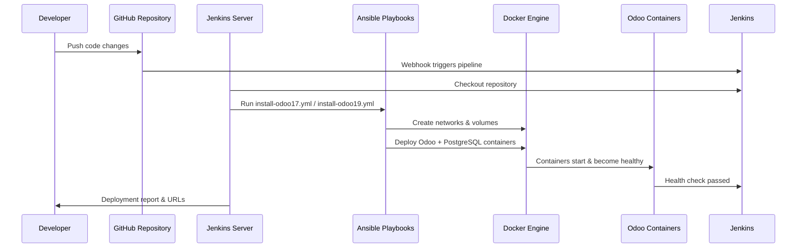
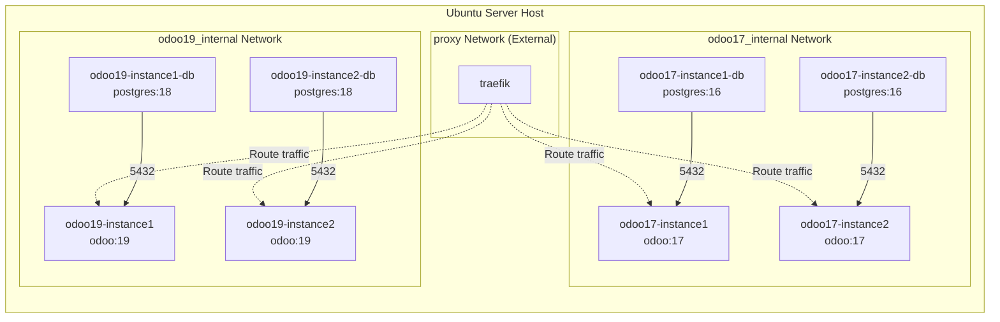
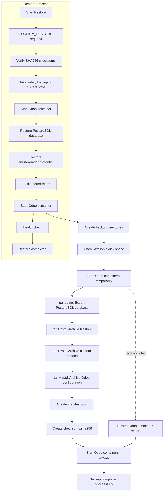
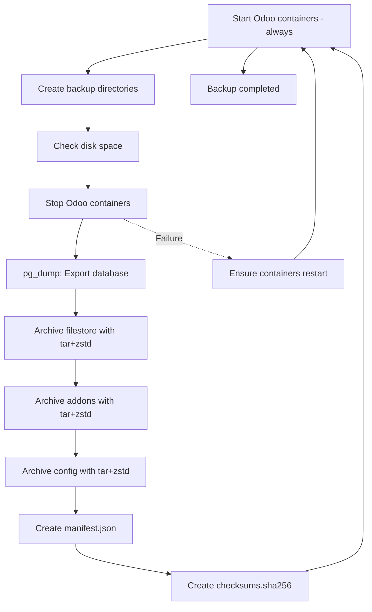

# 🚀 نشر Odoo متعدد الإصدارات — Odoo Multi-Version Deployment

> **النظام المدعوم:** Ubuntu Server 22.04 LTS  
> **المكونات:** Odoo 17، Odoo 19، PostgreSQL 16، PostgreSQL 18، Docker، Docker Compose، Ansible، Jenkins، Traefik  
> **المستوى:** مشرف نظام / مسؤول بنية تحتية / مهندس DevOps  
> **التاريخ:** نوفمبر 2026  
> **الإصدار:** 1.0  
> **الحالة:** Production Ready

---

## 📋 جدول المحتويات

1. [نظرة عامة](#-نظرة-عامة)
2. [أهداف المشروع](#-أهداف-المشروع)
3. [المميزات الرئيسية](#-المميزات-الرئيسية)
4. [الهندسة المعمارية](#-الهندسة-المعمارية)
5. [سير عمل النشر](#-سير-عمل-النشر)
6. [Jenkins + أتمتة Ansible](#-Jenkins--أتمتة-Ansible)
7. [الخدمات والشبكات في Docker](#-الخدمات-والشبكات-في-Docker)
8. [مكدس التقنية](#-مكدس-التقنية)
9. [هيكل الدليل](#-هيكل-الدليل)
10. [نسخ Odoo والتكوين](#-نسخ-Odoo-والتكوين)
11. [منافذ الخدمات والنطاقات](#-منافذ-الخدمات-والنطاقات)
12. [متطلبات النظام](#-متطلبات-النظام)
13. [قائمة التحقق قبل التثبيت](#-قائمة-التحقق-قبل-التثبيت)
14. [التثبيت](#-التثبيت)
15. [Jenkins + أتمتة Ansible (تفصيلي)](#-Jenkins-+-أتمتة-Ansible-تفصيلي)
16. [النسخ الاحتياطي والاستعادة من الكوارث](#-النسخ-الاحتياطي والاستعادة-من-الكوارث)
17. [النسخ الاحتياطي لإعدادات نظام Ubuntu](#-النسخ-الاحتياطي-لإعدادات-نظام-Ubuntu)
18. [الأمان والصلاحيات](#-الأمان-والصلاحيات)
19. [Traefik وHTTPS](#-Traefik-وHTTPS)
20. [استكشاف الأخطاء وإصلاحها](#-استكشاف-الأخطاء-وإصلاحها)
21. [إضافة إصدارات مستقبلية](#-إضافة-إصدارات-مستقبلية)
22. [المساهمة](#-المساهمة)
23. [الترخيص](#-الترخيص)
24. [الدعم](#-الدعم)

---

## 1. 📖 نظرة عامة

يوفر مشروع **Odoo Multi-Version Deployment** بنية تحتية موحدة وجاهزة للإنتاج لنشر وإدارة إصدارات متعددة من Odoo على خادم واحد. يشغل كل إصدار (Odoo 17 وOdoo 19) نسختين مستقلتين مع قواعد بيانات PostgreML معزولة، ومجلدات بيانات منفصلة، وحاويات Docker مخصصة، كلها أمامها بروكسي عكسي مشترك Traefik للوصول عبر HTTPS.

### أهداف المشروع

- **دعم إصدارات متعددة**: نشر Odoo 17 (PostgreSQL 16) وOdoo 19 (PostgreSQL 18) جنبًا إلى جنب
- **عزل النسخ**: تعمل كل نسخة في شبكتها الداخلية الخاصة مع قاعدة بيانات وملحقات منفصلة
- **عدم اعتماد على تبعيات خارجية**: عدم الاعتماد على صور Docker من جهات خارجية أو قوالب Compose خارجية
- **نشر متجانس (Idempotent)**: جميع Playbooks وسكريبتات أنsible آمنة لإعادة التشغيل دون فقدان البيانات
- **نسخ احتياطي واستعادة شامل**: استعادة كاملة من الكوارث مع التحقق من السلامة عبر SHA256
- **أقل امتياز أمني**: تعمل جميع الحاويات كمستخدم غير جذر (UID 999)

---

## 2. 🌟 المميزات الرئيسية

| # | الميزة | الوصف |
|---|---------|----------|
| 1 | 🐳 **تغليف الحاويات عبر Docker** | يعمل Odoo وPostgreSQL في حاويات معزولة لكل نسخة |
| 2 | 🔄 **دعم إصدارات متعددة** | Odoo 17 + PostgreSQL 16 وOdoo 19 + PostgreSQL 18 |
| 3 | 📦 **نسختان لكل إصدار** | نسخ مستقلة من Odoo 17 instance1/2 وOdoo 19 instance1/2 |
| 4 | 🔀 **بروكسي عكسي Traefik** | بروكسي مشترك مع HTTPS، شهادات SSL تلقائية عبر Let's Encrypt |
| 5 | 🤖 **أتمتة Ansible** | Playbooks متجانسة للنشر، النسخ الاحتياطي، الاستعادة، التحقق |
| 6 | 🔧 **تكامل Jenkins CI/CD** | خط أنابيب مبني علىPipeline للنشر والتنظيم الاحتياطي |
| 7 | 💾 **نسخ احتياطي واستعادة من الكوارث** | نسخ احتياطي كامل، استعادة، تحقق، وسياسات الاحتفاظ |
| 8 | 🖥️ **نسخ احتياطي لنظام Ubuntu** | نسخ مستقل لإعدادات الخادم (SSH، Netplan، Docker، إلخ) |
| 9 | 🔐 **أمان بأقل امتياز** | تعمل جميع الحاويات كـ UID 999؛ الأسرار عبر Ansible Vault |
| 10 | 📋 **Manifest وChecksums** | تتضمن كل نسخة احتياطية manifest.json ومجموعات تحقق SHA256 |

---

## 3. 🏗 الهندسة المعمارية

### البنية المعمارية للنظام

```
Internet / WAN
     │
     ▼
Users / Browsers
     │
     │ HTTPS
     ▼
Traefik Reverse Proxy (Shared)
├── HTTPS / SSL Termination
├── HTTP Routers
└── Let's Encrypt Certificates
     │ Route
     ├─→ Odoo 17 Internal Network (odoo17_internal)
     │    ├── odoo17-instance1 (Odoo 17 + PostgreSQL 16)
     │    └── odoo17-instance2 (Odoo 17 + PostgreSQL 16)
     │ Route
     ├─→ Odoo 19 Internal Network (odoo19_internal)
     │    ├── odoo19-instance1 (Odoo 19 + PostgreSQL 18)
     │    └── odoo19-instance2 (Odoo 19 + PostgreSQL 18)
     │ Route
     └─→ pgAdmin 4
     │ Data
     ├─→ /data/odoo17/instance1/postgresql
     ├─→ /data/odoo17/instance2/postgresql
     ├─→ /data/odoo19/instance1/postgresql
     ├─→ /data/odoo19/instance2/postgresql
     └─→ /data/backups/
     │ Backup
     ├─→ odoo17 backups
     ├─→ odoo19 backups
```

### سير عمل النشر



### Jenkins + أتمتة Ansible



### الخدمات والشبكات في Docker



### سير عمل النسخ الاحتياطي والاستعادة



---

## 4. 🛠 مكدس التقنية

| المكون | التقنية | الإصدار | الغرض |
|-----------|------------|---------|---------|
| نظام التشغيل | Ubuntu Server | 22.04+ | نظام تشغيل المضيف |
| محرك الحاويات | Docker | 20.10+ | وقت تشغيل الحاويات |
| تنسيق الحاويات | Docker Compose | v2 | نشر حاويات متعددة |
| إدارة التكوين | Ansible | Core + collections | بنية تحتية ككود |
| التكامل/nشر المستمر | Jenkins | LTS | أتمتة خطوط الأنابيب |
| البروكسي العكسي | Traefik | v2+ | HTTPS، إنهاء SSL، التوجيه |
| التطبيق | Odoo | 17 و 19 | تطبيق تخطيط موارد المؤسسات |
| قاعدة البيانات | PostgreSQL | 16 و 18 | قاعدة بيانات التطبيق |
| ضغط النسخ الاحتياطي | zstd | أحدث | أرشيفات مضغوطة بكفاءة عالية |
| السلامة | SHA256 | — | التحقق من النسخ الاحتياطي |
| الأسرار | Ansible Vault | — | بيانات اعتماد مشفرة |
| إدارة الإصدارات | Git | — | إدارة كود المصدر |

---

## 5. 📁 هيكل الدليل

```text
Odoo-MultiVersion-Deployment/
├── Jenkinsfile                              # خط أنابيب Jenkins موحد (Odoo 17 و 19)
├── README.md                                # توثيق المشروع
├── requirements.yml                         # متطلبات مجموعات Ansible
├── .gitignore                               # قواعد تجاهل Git
│
├── Jenkins/                                 # تعريفات خطوط أنابيب Jenkins
│   ├── install-odoo17.Jenkinsfile           # خط أنابيب نشر Odoo 17
│   ├── install-odoo19.Jenkinsfile           # خط أنابيب نشر Odoo 19
│   ├── backup.Jenkinsfile                   # خط أنابيب النسخ الاحتياطي
│   ├── restore.Jenkinsfile                  # خط أنابيب الاستعادة (يتطلب تأكيد)
│   ├── verify-backups.Jenkinsfile           # خط أنابيب التحقق من النسخ الاحتياطية
│   └── system-config-backup.Jenkinsfile     # خط أنابيب نسخ إعدادات نظام Ubuntu
│
├── scripts/                                 # سكريبتات أتمتة Terminal
│   ├── install-odoo17.sh                    # سكريبت تثبيت Odoo 17
│   ├── install-odoo19.sh                    # سكريبت تثبيت Odoo 19
│   ├── health-check.sh                      # سكريبت فحص صحة الخدمات
│   ├── backup.sh                            # سكريبت نسخ احتياطي لـ Odoo
│   ├── restore.sh                           # سكريبت استعادة Odoo
│   ├── verify-backups.sh                    # التحقق من سلامة النسخ الاحتياطية
│   ├── list-backups.sh                      # عرض النسخ الاحتياطية المتاحة
│   ├── backup-system-config.sh              # نسخ إعدادات نظام Ubuntu
│   └── restore-system-config.sh             # استعادة إعدادات نظام Ubuntu
│
├── ansible/                                 # أتمتة Ansible
│   ├── inventory/
│   │   └── hosts.ini                        # مخزون المضيفين المستهدف
│   ├── group_vars/
│   │   └── all.yml                          # متغيرات Ansible مشتركة
│   ├── playbooks/
│   │   ├── install-odoo17.yml               # Playbook تثبيت Odoo 17
│   │   ├── install-odoo19.yml               # Playbook تثبيت Odoo 19
│   │   ├── backup.yml                       # Playbook النسخ الاحتياطي
│   │   ├── restore.yml                      # Playbook الاستعادة
│   │   ├── verify.yml                       # Playbook التحقق من النسخ الاحتياطية
│   │   └── system-config-backup.yml         # Playbook نسخ إعدادات نظام Ubuntu
│   ├── roles/
│   │   ├── system/                          # إعداد المجلدات والشبكة
│   │   ├── permissions/                     # صلاحيات أقل امتياز للملفات
│   │   ├── docker/                          # نشر Docker Compose
│   │   ├── postgresql/                      # مستخدمين وقواعد بيانات PostgreSQL
│   │   ├── odoo/                            # تكوين وتحقق Odoo
│   │   ├── traefik/                         # التحقق من اتصال Traefik
│   │   ├── backup/                          # مهام نسخ احتياطي لـ Odoo
│   │   ├── restore/                         # مهام استعادة Odoo
│   │   ├── verify/                          # مهام التحقق من النسخ الاحتياطية
│   │   └── system-config-backup/            # مهام نسخ إعدادات نظام Ubuntu
│   └── templates/
│       └── odoo/
│           └── odoo.conf.j2                 # قالب تكوين Odoo
│
├── versions/                                # متغيرات خاصة بالإصدار
│   ├── odoo17.yml                           # تعريفات نسخ Odoo 17
│   └── odoo19.yml                           # تعريفات نسخ Odoo 19
│
├── docker/                                  # قوالب Docker Compose
│   ├── odoo17-compose.yml.j2                # قالب Compose لـ Odoo 17 (Jinja2)
│   └── odoo19-compose.yml.j2                # قالب Compose لـ Odoo 19 (Jinja2)
│
└── backup/                                  # سياسات ومخططات النسخ الاحتياطي
    ├── backup-policy.yml                    # تعريف سياسة النسخ الاحتياطي
    ├── retention.yml                        # سياسة الاحتفاظ بالنسخ الاحتياطية
    └── manifest-schema.json                 # مخطط JSON لبيانات النسخة الاحتياطية
```

---

## 6. 🔧 نسخ Odoo والتكوين

ينشر المشروع **نسختين مستقلتين لكل إصدار من Odoo**، لكل نسخة قاعدة بيانات خاصة بها، ومجلد بيانات، وحاويات Docker خاصة.

### تكوين Odoo 17

| Instance | النطاق | الحاوية (Odoo) | الحاوية (قاعدة البيانات) | قاعدة البيانات | مستخدم قاعدة البيانات | مسار البيانات | مسار التكوين | PostgreSQL |
|----------|--------|------------------|----------------|----------|---------|-----------|-------------|------------|
| النسخة 1 | `${ODOO17_INSTANCE1_DOMAIN}` | `odoo17-instance1` | `odoo17-instance1-db` | `odoo17_db1` | `odoo17_instance1` | `/data/odoo17/instance1` | `/opt/odoo17/instance1` | PostgreSQL 16 |
| النسخة 2 | `${ODOO17_INSTANCE2_DOMAIN}` | `odoo17-instance2` | `odoo17-instance2-db` | `odoo17_db2` | `odoo17_instance2` | `/data/odoo17/instance2` | `/opt/odoo17/instance2` | PostgreSQL 16 |

### تكوين Odoo 19

| Instance | النطاق | الحاوية (Odoo) | الحاوية (قاعدة البيانات) | قاعدة البيانات | مستخدم قاعدة البيانات | مسار البيانات | مسار التكوين | PostgreSQL |
|----------|--------|------------------|----------------|----------|---------|-----------|-------------|------------|
| النسخة 1 | `${ODOO19_INSTANCE1_DOMAIN}` | `odoo19-instance1` | `odoo19-instance1-db` | `odoo19_db1` | `odoo19_instance1` | `/data/odoo19/instance1` | `/opt/odoo19/instance1` | PostgreSQL 18 |
| النسخة 2 | `${ODOO19_INSTANCE2_DOMAIN}` | `odoo19-instance2` | `odoo19-instance2-db` | `odoo19_db2` | `odoo19_instance2` | `/data/odoo19/instance2` | `/opt/odoo19/instance2` | PostgreSQL 18 |

### الإعدادات المشتركة

| الإعداد | Odoo 17 | Odoo 19 |
|---------|---------|---------|
| صورة Docker | `odoo:17` | `odoo:19` |
| صورة PostgreSQL | `postgres:16` | `postgres:18` |
| مسار PGDATA | `/var/lib/postgresql/data` | `/var/lib/postgresql/18/docker` |
| منفذ HTTP لـ Odoo | 8069 | 8069 |
| منفذ الدردشة الحية | 8072 | 8072 |
| مستخدم الحاوية | `999:999` | `999:999` |
| نقطة دخول Traefik | `websecure` | `websecure` |
| resolvers الشهادات | `letsencrypt` | `letsencrypt` |

---

## 7. 🔌 منافذ الخدمات والنطاقات

| الخدمة | النسخة | المنفذ | البروتوكول | النطاق |
|---------|----------|------|----------|--------|
| لوحة تحكم Traefik | مشتركة | 8080 | HTTP | — |
| HTTP Odoo | odoo17-instance1 | 8069 | HTTPS عبر Traefik | `${ODOO17_INSTANCE1_DOMAIN}` |
| HTTP Odoo | odoo17-instance2 | 8069 | HTTPS عبر Traefik | `${ODOO17_INSTANCE2_DOMAIN}` |
| HTTP Odoo | odoo19-instance1 | 8069 | HTTPS عبر Traefik | `${ODOO19_INSTANCE1_DOMAIN}` |
| HTTP Odoo | odoo19-instance2 | 8069 | HTTPS عبر Traefik | `${ODOO19_INSTANCE2_DOMAIN}` |
| الدردشة الحية | جميع النسخ | 8072 | HTTPS عبر Traefik | نفس نطاق Odoo |
| PostgreSQL | جميع النسخ | 5432 | داخلي (شبكة Docker) | غير مكشوف خارجياً |

---

## 8. 💻 متطلبات النظام

### متطلبات الخادم الدنيا

| المورد | الحد الأدنى | الموصى به |
|----------|---------|-------------|
| المعالج | 2 نوى | 4 نوى أو أكثر |
| الذاكرة | 4 جيجابايت | 8+ جيجابايت |
| التخزين | 100 جيجابايت SSD | 500+ جيجابايت SSD |
| نظام التشغيل | Ubuntu Server 22.04 LTS | Ubuntu Server 24.04 LTS |

### البرامج المطلوبة

| البرنامج | الإصدار | طريقة التثبيت |
|----------|---------|---------------------|
| Docker Engine | 20.10+ | apt / مستودع Docker الرسمي |
| Docker Compose | v2 | ملحق Docker |
| Ansible | Core + community collections | pip / apt |
| Python3 | 3.8+ | apt |
| Git | 2.x | apt |
| Traefik | v2+ | منشور بشكل منفصل (شبكة خارجية) |

### قائمة التحقق قبل التثبيت

- [ ] نظام Ubuntu Server مثبت ومحدّث
- [ ] Docker وDocker Compose مثبتان
- [ ] أنsible مثبت مع `community.docker` collection
- [ ] شبكة Docker `proxy` منشأة (مشتركة مع Traefik)
- [ ] سجلات DNS تشير إلى عنوان IP الخادم لجميع النطاقات
- [ ] Traefik يعمل مع resolvers شهادات Let's Encrypt مconfigured
- [ ] بيانات اعتماد Jenkins مconfigured (GitHub، Ansible Vault، كلمات مرور Odoo)

---

## 9. 🚀 التثبيت

### عبر Terminal

#### تثبيت Odoo 17

```bash
cd /opt/Odoo-MultiVersion-Deployment
sudo ./scripts/install-odoo17.sh
```

#### تثبيت Odoo 19

```bash
cd /opt/Odoo-MultiVersion-Deployment
sudo ./scripts/install-odoo19.sh
```

#### فحص الصحة

```bash
# فحص نسخة معينة
sudo ./scripts/health-check.sh instance1 8069 8072

# فحص جميع النسخ (Odoo 17)
sudo ./scripts/health-check.sh odoo17-instance1 8069 8072
sudo ./scripts/health-check.sh odoo17-instance2 8069 8072

# فحص جميع النسخ (Odoo 19)
sudo ./scripts/health-check.sh odoo19-instance1 8069 8072
sudo ./scripts/health-check.sh odoo19-instance2 8069 8072
```

### عبر Jenkins

افتح خادم Jenkins الخاص بك وشغل خطوط الأنابيب التالية:

| خط الأنابيب | ملف Jenkinsfile | الغرض |
|----------|-------------|---------|
| تثبيت Odoo 17 | `Jenkins/install-odoo17.Jenkinsfile` | نشر نسختين من Odoo 17 |
| تثبيت Odoo 19 | `Jenkins/install-odoo19.Jenkinsfile` | نشر نسختين من Odoo 19 |
| النسخ الاحتياطي | `Jenkins/backup.Jenkinsfile` | نسخ احتياطي لنسخ مختارة أو كلها |
| الاستعادة | `Jenkins/restore.Jenkinsfile` | استعادة نسخة احتياطية (يتطلب تأكيد) |
| التحقق من النسخ الاحتياطية | `Jenkins/verify-backups.Jenkinsfile` | التحقق من سلامة النسخ الاحتياطية |
| نسخ إعدادات النظام | `Jenkins/system-config-backup.Jenkinsfile` | نسخ إعدادات خادم Ubuntu |

#### معلمات بناء Jenkins

| المعلمة | النوع | الافتراضي | الوصف |
|-----------|------|---------|-------------|
| `ODOO_VERSION` | Choice | `odoo17` | إصدار Odoo للنشر |
| `ODOO_ADMIN_PASSWORD` | String | — | كلمة مرور مشرف Odoo |
| `POSTGRES_PASSWORD` | String | — | كلمة مرور PostgreSQL |
| `CONFIRM_RESTORE` | Boolean | `false` | تأكيد عملية الاستعادة |
| `RESTORE_TYPE` | Choice | `existing` | نوع الاستعادة: existing / new-instance |
| `BACKUP_ID` | String | — | معرف النسخة الاحتياطية للاستعادة |
| `NEW_INSTANCE_NAME` | String | — | اسم النسخة الجديدة (لاستعادة new-instance) |
| `ODOO_VERSION` (backup) | Choice | `all` | odoo17, odoo18, odoo19، أو all |
| `INSTANCE` (backup) | Choice | `all` | instance1, instance2، أو all |
| `BACKUP_TYPE` | Choice | `full` | نوع النسخة الاحتياطية للتنفيذ |
| `VERIFY_TYPE` | Choice | `checksums` | نوع التحقق |

---

## 10. 🔄 Jenkins + أتمتة Ansible (تفصيلي)

يتبع النشر **نهجًا מבוסס Ansible**: يقوم Jenkins بتشغيل Playbooks أنsible، مما يضمن نتائج متطابقة سواء نُشر عبر خط أنابيب Jenkins أو عبر سكريبتات Terminal.

### تدفق التنفيذ

1. **Checkout**: يقوم Jenkins باستنساخ المستودع من GitHub
2. **Validation**: التحقق من Docker، Compose، مساحة القرص، والذاكرة
3. **مجموعات أنsible**: تثبيت المجموعات المطلوبة (`community.docker`، `community.general`، `ansible.posix`)
4. **الأسرار**: إدخال كلمات مرور مشرف Odoo وPostgreSQL عبر بيانات اعتماد Jenkins وتشفيرها بـ Ansible Vault
5. **النشر**: تشغيل Playbook أنsible بالأدوار بالترتيب: `system` → `permissions` → `docker` → `postgresql` → `odoo` → `traefik`
6. **فحوصات الصحة**: التحقق من حالة الحاويات والنقاط النهائية لـ HTTP
7. **التقرير**: تقرير ملخص النشر مع حالة الحاويات وعناوين URL للوصول

### التجانس (Idempotency)

جميع Playbooks أنsible وسكريبتات Terminal **متجانسة** — آمنة لإعادة التشغيل دون تكرار الموارد أو الإضرار بالبيانات الموجودة.

---

## 11. 💾 النسخ الاحتياطي والاستعادة من الكوارث

### سياسة النسخ الاحتياطي

| نوع النسخة الاحتياطية | الجدول الزمني | فترة الاحتفاظ |
|-------------|----------|-----------|
| نسخة كاملة يومية | 02:00 يوميًا | 7 أيام |
| نسخة كاملة أسبوعية | 02:00 الأحد | 4 أسابيع |
| نسخة كاملة شهرية | 02:00 أول يوم في الشهر | 3 أشهر |
| نسخة كاملة سنوية | 02:00 أول يوم في يناير | سنة واحدة |

### المكونات التي يتم نسخها احتياطيًا

| المكون | الأداة | الضغط | مشفر |
|-----------|------|-------------|-----------|
| قاعدة بيانات PostgreSQL | `pg_dump` | — | لا |
| المرفق (filestore) | `tar` + `zstd` | zstd | لا |
| الإضافات المخصصة | `tar` + `zstd` | zstd | لا |
| تكوين Odoo | `tar` + `zstd` | zstd | لا |
| البيئة / الأسرار | Ansible Vault | — | نعم |
| تكوين Traefik | `tar` + `gpg` | gpg | نعم |
| ملفات Docker Compose | Git | — | لا |
| Playbooks أنsible | Git | — | لا |
| تكوين Jenkins | Jenkins Backup Plugin | — | لا |

### هيكل مجلدات النسخ الاحتياطية

```text
/data/backups/
├── odoo17/
│   ├── instance1/
│   │   └── 2026-11-04_020000/
│   │       ├── database_20261104_020000.sql
│   │       ├── filestore_20261104_020000.tar.zst
│   │       ├── addons_20261104_020000.tar.zst
│   │       ├── config_20261104_020000.tar.zst
│   │       ├── manifest.json
│   │       └── checksums.sha256
│   │
│   └── instance2/

├── odoo19/
│   ├── instance1/
│   │   └── 2026-11-04_020000/
│   │       ├── database_20261104_020000.sql
│   │       ├── filestore_20261104_020000.tar.zst
│   │       ├── addons_20261104_020000.tar.zst
│   │       ├── config_20261104_020000.tar.zst
│   │       ├── manifest.json
│   │       └── checksums.sha256
│   │
│   └── instance2/

├── infrastructure/
├── jenkins/
└── reports/
```

### سير عمل النسخ الاحتياطي



### النسخ الاحتياطي عبر Terminal

```bash
# نسخ احتياطي لنسخة معينة (يتم اكتشاف الإصدار تلقائيًا من الحاويات)
sudo ./scripts/backup.sh instance1 /data/backups

# نسخ احتياطي مع إصدار صريح
sudo ./scripts/backup.sh instance1 odoo17 /data/backups/odoo17
sudo ./scripts/backup.sh instance2 odoo17 /data/backups/odoo17
sudo ./scripts/backup.sh instance1 odoo19 /data/backups/odoo19
sudo ./scripts/backup.sh instance2 odoo19 /data/backups/odoo19
```

### الاستعادة عبر Terminal

```bash
# استعادة إلى نسخة موجودة (يُؤخذ نسخة أمان تلقائيًا)
sudo ./scripts/restore.sh odoo17-instance1-20261104 odoo17 instance1 existing

# استعادة كنسخة جديدة
sudo ./scripts/restore.sh odoo17-instance1-20261104 odoo17 instance1 new-instance odoo17-instance3
```

### التحقق من النسخ الاحتياطية عبر Terminal

```bash
# التحقق من جميع النسخ الاحتياطية
sudo ./scripts/verify-backups.sh /data/backups

# التحقق من إصدار معين
sudo ./scripts/verify-backups.sh /data/backups odoo17
```

### عرض النسخ الاحتياطية المتاحة

```bash
# عرض جميع النسخ الاحتياطية
sudo ./scripts/list-backups.sh /data/backups

# عرض إصدار معين
sudo ./scripts/list-backups.sh /data/backups odoo19
```

### ملف manifest.json (manifest.json)

تحتوي كل نسخة احتياطية على manifest بالمخطط التالي:

```json
{
  "backup_id": "odoo17-instance1-20261104",
  "odoo_version": "17",
  "postgres_version": "16",
  "instance": "instance1",
  "database": "odoo17_db1",
  "backup_type": "full",
  "created_at": "2026-11-04T02:00:00+02:00",
  "database_backup": "database_20261104_020000.sql",
  "filestore_backup": "filestore_20261104_020000.tar.zst",
  "addons_backup": "addons_20261104_020000.tar.zst",
  "config_backup": "config_20261104_020000.tar.zst",
  "integrity_check": "sha256",
  "status": "completed"
}
```

---

## 12. 🖥️ النسخ الاحتياطي لإعدادات نظام Ubuntu

نسخ احتياطي مستقل لإعدادات خادم Ubuntu (منفصل عن بيانات Odoo):

**ما يتم نسخه احتياطيًا:**

| المكون | المسار |
|-----------|------|
| تكوين الشبكة | `/etc/netplan` |
| تكوين SSH | `/etc/ssh` |
| برنامج Docker | `/etc/docker` |
| جدول التقسيم | `/etc/fstab` |
| اسم المضيف | `/etc/hostname` |
| ملف المضيفين | `/etc/hosts` |
| حزم النظام | `/etc/apt` |
| خدمات systemd | `/etc/systemd/system` |
| مهام cron | `/etc/cron.d` |
| جدار الحماية | `/etc/ufw` |
| المشاريع | `/opt` |
| معلومات النظام | `system-info/` (hostnamectl, lsblk, findmnt, df, ip, docker) |

**الأوامر:**

```bash
# إنشاء نسخ احتياطي لإعدادات النظام
sudo ./scripts/backup-system-config.sh

# مع التشفير
export ENCRYPT=true
export ENCRYPT_PASSWORD="your-secure-password"
sudo ./scripts/backup-system-config.sh

# استعادة إعدادات النظام (مرحلية - تأكيد لكل مرحلة)
sudo ./scripts/restore-system-config.sh 2026-11-04_020000
```

> ⚠️ **تحذير أمني**: قد تختلف إعدادات Netplan وSSH وfstab بعد إعادة تثبيت نظام التشغيل. راجع كل إعداد قبل الاستعادة لتجنب فقدان الوصول إلى الخادم.

---

## 13. 🔐 الأمان والصلاحيات

### نموذج أقل امتياز

تتبع جميع المكونات مبدأ أقل امتياز:

| المكون | المستخدم/المجموعة | الصلاحيات | الوصف |
|-----------|-----------|-------------|-------------|
| حاوية Odoo | `999:999` | غير جذر | تعمل كمستخدم غير ذي امتياز |
| حاوية PostgreSQL | `999:999` | غير جذر | تعمل كمستخدم غير ذي امتياز |
| دليل بيانات PostgreSQL | `999:999` | `0700` | وصول للمالك فقط |
| ملف تكوين Odoo | `999:999` | `0640` | قراءة/كتابة للمالك، قراءة للمجموعة |
| دليل تكوين Odoo | `999:999` | `0750` | وصول للمالك + المجموعة |
| دليل الإضافات | `999:999` | `0755` | وصول قياسي |
| مأخذ Docker | `root:docker` | `0660` | وصول لمجموعة Docker |
| أدلة النسخ الاحتياطي | `root:root` | `0750` | وصول للمالك + المجموعة |

### مستخدم النظام

يتم إنشاء مستخدم نظام `odoo` وإضافته إلى مجموعة `docker` لإدارة الحاويات دون صلاحيات الجذر.

### إدارة الأسرار

| السر | طريقة التخزين | معرف بيانات اعتماد Jenkins |
|--------|---------------|----------------------|
| كلمة مرور مشرف Odoo | Ansible Vault | `odoo17-admin-password` / `odoo19-admin-password` |
| كلمة مرور PostgreSQL | Ansible Vault | `odoo17-postgres-password` / `odoo19-postgres-password` |
| كلمة مرور Ansible Vault | بيانات اعتماد Jenkins | `ansible-vault-password` |
| الوصول إلى GitHub | بيانات اعتماد Jenkins | `github-credentials` |

> ⚠️ **تحذير إنتاج**: كلمات المرور الافتراضية (`odoo17`، `odoo19`) للاختبار فقط. استبدلها بكلمات مرور آمنة عبر بيانات اعتماد Jenkins أو Ansible Vault قبل النشر في بيئة إنتاج.

---

## 14. 🌐 Traefik وHTTPS

### التكوين

| الإعداد | القيمة |
|---------|-------|
| نقطة الدخول | `websecure` |
| resolvers الشهادات | `letsencrypt` |
| TLS | مفعلة |
| الشبكة الخارجية | `proxy` |

### النطاقات

| النسخة | الرابط |
|----------|-----|
| Odoo 17 - النسخة 1 | `https://${ODOO17_INSTANCE1_DOMAIN}` |
| Odoo 17 - النسخة 2 | `https://${ODOO17_INSTANCE2_DOMAIN}` |
| Odoo 19 - النسخة 1 | `https://${ODOO19_INSTANCE1_DOMAIN}` |
| Odoo 19 - النسخة 2 | `https://${ODOO19_INSTANCE2_DOMAIN}` |

### دعم WebSocket

لكل نسخة موجه WebSocket مخصص ذات أولوية 100 لمسارات `/websocket`، مما يضمن عمل ميزة الدردشة الحية بشكل صحيح عبر HTTPS.

---

## 15. 🐛 استكشاف الأخطاء وإصلاحها

| المشكلة | السبب المحتمل | الحل |
|-------|---------------|----------|
| الحاوية تفشل في التشغيل | المنفذ مستخدم بالفعل | تحقق من `docker ps` وأوقف الحاويات المتعارضة |
| PostgreSQL غير جاهز | الحاوية لا تزال في فترة التهيئة | انتظر وأعد محاولة `pg_isready` |
| استجابة HTTP لـ Odoo غير صحيحة | تكوين أو منفذ خاطئ | تحقق من `odoo.conf` وسجلات الحاوية |
| فشل توجيه Traefik | شبكة `proxy` مفقودة | أنشئ الشبكة: `docker network create --driver bridge --subnet 172.28.0.0/16 proxy` |
| عدم تطابق checksum في النسخة الاحتياطية | ملفات نسخة احتياطية تالفة | احذف وأنشئ نسخة احتياطية جديدة؛ تحقق من مساحة القرص |
| فشل الاستعادة | ملف manifest.json مفقود | تحقق من بنية دليل النسخة الاحتياطية |
| رفض إذن في دليل البيانات | ملكية خاطئة | شغّل دور الصلاحيات: `ansible-playbook install-odooXX.yml` |
| رفض إذن للوصول إلى مأخذ Docker | المستخدم ليس في مجموعة Docker | أضف المستخدم: `sudo usermod -aG docker $USER` |
| فشل فك تشفير Ansible Vault | كلمة مرور Vault خاطئة | تحقق من `ansible-vault-password` |
| فشل فحص صحة HTTP | Odoo لا يزال يعمل | انتظر 60-120 ثانية وأعد المحاولة |

### عرض سجلات الحاويات

```bash
# سجلات حاوية Odoo
docker logs -f odoo17-instance1
docker logs -f odoo19-instance1

# سجلات حاوية PostgreSQL
docker logs -f odoo17-instance1-db
docker logs -f odoo19-instance1-db

# تحقق من حالة الحاوية
docker ps --filter "name=odoo17" --format "table {{.Names}}\t{{.Status}}"
docker ps --filter "name=odoo19" --format "table {{.Names}}\t{{.Status}}"
```

---

## 16. ➕ إضافة إصدارات مستقبلية

لإضافة إصدار جديد من Odoo (على سبيل المثال، Odoo 18 أو 20):

1. أنشئ `versions/odooXX.yml` مع تعريفات النسخ
2. أنشئ `docker/odooXX-compose.yml.j2` قالب Compose
3. أنشئ `scripts/install-odooXX.sh` سكريبت تثبيت
4. أنشئ `ansible/playbooks/install-odooXX.yml` Playbook
5. أضف خيار خط أنابيب في `Jenkinsfile` إذا لزم الأمر

لا حاجة لإعادة بناء النظام من الصفر — تتم إعادة استخدام الأدوار المشتركة.

---

## 17. 🤝 المساهمة

1. Fork المستودع
2. أنشئ فرعًا جديدًا للميزة (`git checkout -b feature/improvement`)
3. التزم بالتغييرات (`git commit -m 'Add improvement'`)
4. Push إلى الفرع (`git push origin feature/improvement`)
5. افتح طلب سحب (Pull Request)

---

## 18. 📄 الترخيص

مرخص بموجب رخصة **MIT**. راجع ملف [LICENSE](LICENSE) للتفاصيل.

---

## 19. 📞 الدعم

لأي مشاكل أو طلبات ميزات أو أسئلة، يرجى فتح Issue على GitHub.

**إصدار التوثيق:** 1.0  
**آخر تحديث:** 2026-11-04  
**حالة المشروع:** Production Ready

---

*تم إعداد هذا الدليل كجزء من نظام إدارة البنية التحتية لـ Odoo (Infrastructure Manager).*
