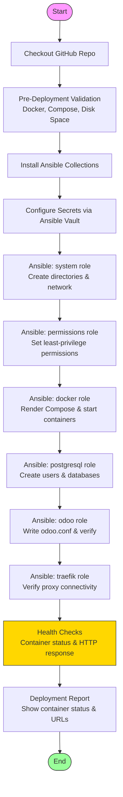
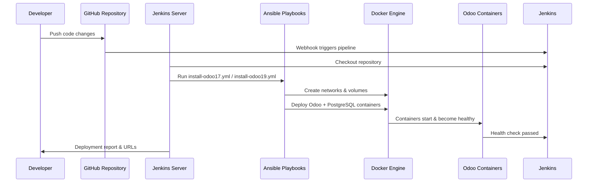
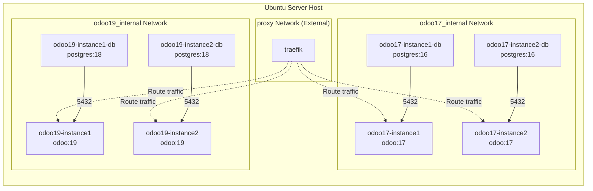
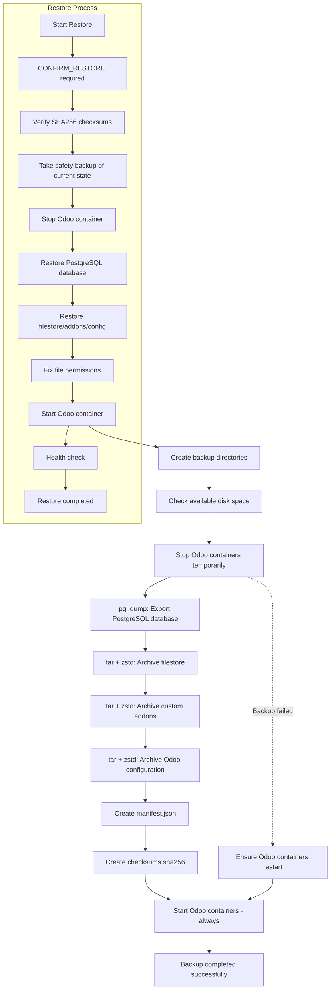
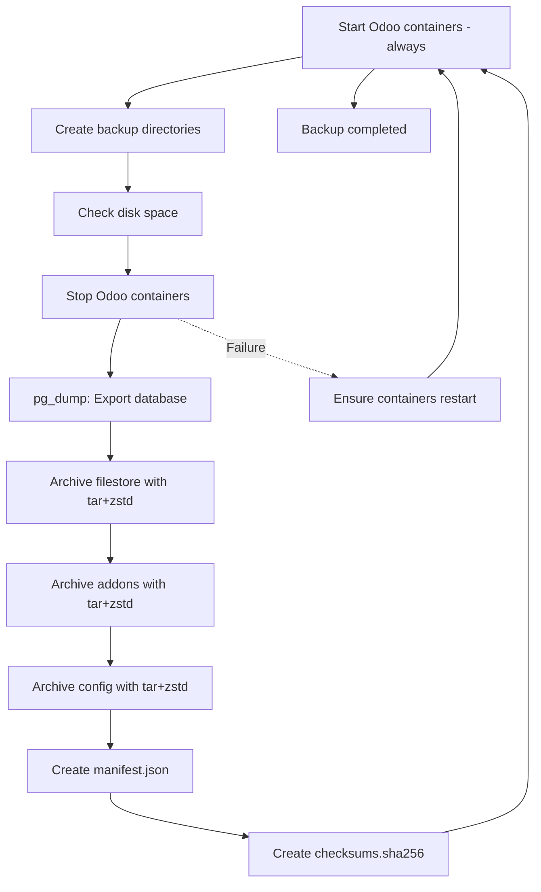

# Odoo Multi-Version Deployment

[](https://www.odoo.com/)
[](https://www.odoo.com/)
[](https://www.postgresql.org/)
[](https://www.postgresql.org/)
[](https://www.docker.com/)
[](https://www.ansible.com/)
[](https://www.jenkins.io/)
[](https://traefik.io/)
[](https://ubuntu.com/server/)
[](LICENSE)
[](https://github.com/)

> **Unified deployment system for multi-version Odoo environments** using Docker, Ansible, Traefik, and Jenkins. Supports Odoo 17 and Odoo 19 with two independent instances per version, isolated PostgreSQL databases, shared Traefik reverse proxy with HTTPS, and a comprehensive backup & disaster recovery system.

---

## Table of Contents

- [Overview](#overview)
- [Key Features](#key-features)
- [Architecture](#architecture)
- [Technology Stack](#technology-stack)
- [Directory Structure](#directory-structure)
- [Odoo Instances & Configuration](#odoo-instances--configuration)
- [Service Ports & Domains](#service-ports--domains)
- [System Requirements](#system-requirements)
- [Installation](#installation)
  - [Via Terminal](#via-terminal)
  - [Via Jenkins](#via-jenkins)
- [Jenkins + Ansible Automation](#jenkins--ansible-automation)
- [Docker Services & Networking](#docker-services--networking)
- [Backup & Disaster Recovery](#backup--disaster-recovery)
  - [Backup Workflow](#backup-workflow)
  - [Restore Workflow](#restore-workflow)
  - [Verify Backups](#verify-backups)
  - [Ubuntu System Configuration Backup](#ubuntu-system-configuration-backup)
- [Security & Permissions](#security--permissions)
- [Traefik & HTTPS](#traefik--https)
- [Troubleshooting](#troubleshooting)
- [Adding Future Versions](#adding-future-versions)
- [Contributing](#contributing)
- [License](#license)

---

## Overview

The **Odoo Multi-Version Deployment** project provides a production-ready, unified infrastructure for deploying and managing multiple Odoo versions on a single server. Each version (Odoo 17 and Odoo 19) runs two independent instances with isolated PostgreSQL databases, separate data directories, and dedicated Docker containers, all fronted by a shared Traefik reverse proxy for HTTPS access.

### Project Goals

- **Multi-version support**: Deploy Odoo 17 (PostgreSQL 16) and Odoo 19 (PostgreSQL 18) side-by-side
- **Instance isolation**: Each instance runs in its own Docker network with separate database and filestore
- **Zero external dependencies**: No reliance on third-party Docker images or external Compose templates
- **Idempotent deployment**: All Ansible playbooks and scripts are safe to re-run without data loss
- **Comprehensive backup & restore**: Full disaster recovery with SHA256 integrity verification
- **Least privilege security**: All containers run as non-root user (UID 999)

---

## Key Features

| Feature | Description |
|---------|-------------|
| 🐳 **Docker Containerization** | Odoo and PostgreSQL run in isolated containers per instance |
| 🔄 **Multi-Version Support** | Odoo 17 + PostgreSQL 16 and Odoo 19 + PostgreSQL 18 |
| 📦 **Two Instances per Version** | Independent Odoo 17 instance1/2 and Odoo 19 instance1/2 |
| 🔀 **Traefik Reverse Proxy** | Shared proxy with HTTPS, automatic SSL via Let's Encrypt |
| 🤖 **Ansible Automation** | Idempotent playbooks for deployment, backup, restore, verify |
| 🔧 **Jenkins CI/CD** | Pipeline-based deployment and backup orchestration |
| 💾 **Backup & Disaster Recovery** | Full backup, restore, verify, and retention policies |
| 🖥️ **Ubuntu System Backup** | Independent backup of server configuration (SSH, Netplan, Docker, etc.) |
| 🔐 **Least Privilege Security** | All containers run as UID 999; secrets via Ansible Vault |
| 📋 **Manifest & Checksums** | Every backup includes manifest.json and SHA256 checksums |

---

## Architecture

### System Architecture

```mermaid
graph TB
    subgraph Internet["Internet / WAN"]
        User[Users / Browsers]
    end

    subgraph Traefik["Traefik Reverse Proxy (Shared)"]
        TLS[HTTPS / SSL Termination]
        Router[HTTP Routers]
        Cert[Let's Encrypt Certificates]
    end

    subgraph Odoo17_Net["Odoo 17 Internal Network (odoo17_internal)"]
        O17I1[odoo17-instance1<br/>Odoo 17 + PostgreSQL 16]
        O17I2[odoo17-instance2<br/>Odoo 17 + PostgreSQL 16]
    end

    subgraph Odoo19_Net["Odoo 19 Internal Network (odoo19_internal)"]
        O19I1[odoo19-instance1<br/>Odoo 19 + PostgreSQL 18]
        O19I2[odoo19-instance2<br/>Odoo 19 + PostgreSQL 18]
    end

    subgraph Storage["Persistent Storage"]
        D17[/data/odoo17/instance1/postgresql]
        D17b[/data/odoo17/instance2/postgresql]
        D19[/data/odoo19/instance1/postgresql]
        D19b[/data/odoo19/instance2/postgresql]
        B[/data/backups/]
    end

    User -->|HTTPS| Traefik
    Traefik -->|Route| O17I1
    Traefik -->|Route| O17I2
    Traefik -->|Route| O19I1
    Traefik -->|Route| O19I2

    O17I1 -->|Data| D17
    O17I2 -->|Data| D17b
    O19I1 -->|Data| D19
    O19I2 -->|Data| D19b

    O17I1 -.->|Backup| B
    O17I2 -.->|Backup| B
    O19I1 -.->|Backup| B
    O19I2 -.->|Backup| B
```

### Deployment Workflow



### Jenkins + Ansible Automation



### Docker Services & Networking



### Backup & Restore Workflow



---

## Technology Stack

| Component | Technology | Version | Purpose |
|-----------|------------|---------|---------|
| Operating System | Ubuntu Server | 22.04+ | Host OS |
| Container Engine | Docker | 20.10+ | Container runtime |
| Container Orchestration | Docker Compose | v2 | Multi-container deployment |
| Configuration Management | Ansible | Core + collections | Infrastructure as Code |
| CI/CD | Jenkins | LTS | Pipeline automation |
| Reverse Proxy | Traefik | v2+ | HTTPS, SSL termination, routing |
| Application | Odoo | 17 & 19 | ERP application |
| Database | PostgreSQL | 16 & 18 | Application database |
| Backup Compression | zstd | Latest | High-compression archives |
| Integrity | SHA256 | — | Backup verification |
| Secrets | Ansible Vault | — | Encrypted credentials |
| Version Control | Git | — | Source code management |

---

## Directory Structure

```
Odoo-MultiVersion-Deployment/
├── Jenkinsfile                              # Unified Jenkins pipeline (Odoo 17 & 19)
├── README.md                                # Project documentation
├── requirements.yml                         # Ansible collections requirements
├── .gitignore                               # Git ignore rules
│
├── Jenkins/                                 # Jenkins pipeline definitions
│   ├── install-odoo17.Jenkinsfile           # Odoo 17 deployment pipeline
│   ├── install-odoo19.Jenkinsfile           # Odoo 19 deployment pipeline
│   ├── backup.Jenkinsfile                   # Backup pipeline
│   ├── restore.Jenkinsfile                  # Restore pipeline (confirmation required)
│   ├── verify-backups.Jenkinsfile           # Backup verification pipeline
│   └── system-config-backup.Jenkinsfile     # Ubuntu system config backup pipeline
│
├── scripts/                                 # Terminal automation scripts
│   ├── install-odoo17.sh                    # Odoo 17 installation script
│   ├── install-odoo19.sh                    # Odoo 19 installation script
│   ├── health-check.sh                      # Service health check script
│   ├── backup.sh                            # Odoo backup script
│   ├── restore.sh                           # Odoo restore script
│   ├── verify-backups.sh                    # Backup integrity verification
│   ├── list-backups.sh                      # List available backups
│   ├── backup-system-config.sh              # Ubuntu system configuration backup
│   └── restore-system-config.sh             # Ubuntu system configuration restore
│
├── ansible/                                 # Ansible automation
│   ├── inventory/
│   │   └── hosts.ini                        # Target host inventory
│   ├── group_vars/
│   │   └── all.yml                          # Shared Ansible variables
│   ├── playbooks/
│   │   ├── install-odoo17.yml               # Odoo 17 installation playbook
│   │   ├── install-odoo19.yml               # Odoo 19 installation playbook
│   │   ├── backup.yml                       # Backup playbook
│   │   ├── restore.yml                      # Restore playbook
│   │   ├── verify.yml                       # Backup verification playbook
│   │   └── system-config-backup.yml         # Ubuntu system backup playbook
│   ├── roles/
│   │   ├── system/                          # Directory & network setup
│   │   ├── permissions/                     # Least-privilege file permissions
│   │   ├── docker/                          # Docker Compose deployment
│   │   ├── postgresql/                      # PostgreSQL users & databases
│   │   ├── odoo/                            # Odoo configuration & validation
│   │   ├── traefik/                         # Traefik connectivity verification
│   │   ├── backup/                          # Odoo backup tasks
│   │   ├── restore/                         # Odoo restore tasks
│   │   ├── verify/                          # Backup verification tasks
│   │   └── system-config-backup/            # Ubuntu system backup tasks
│   └── templates/
│       └── odoo/
│           └── odoo.conf.j2                 # Odoo configuration template
│
├── versions/                                # Version-specific variables
│   ├── odoo17.yml                           # Odoo 17 instance definitions
│   └── odoo19.yml                           # Odoo 19 instance definitions
│
├── docker/                                  # Docker Compose templates
│   ├── odoo17-compose.yml.j2                # Odoo 17 Compose template (Jinja2)
│   └── odoo19-compose.yml.j2                # Odoo 19 Compose template (Jinja2)
│
└── backup/                                  # Backup policies & schemas
    ├── backup-policy.yml                    # Backup policy definition
    ├── retention.yml                        # Backup retention policy
    └── manifest-schema.json                 # Backup manifest JSON schema
```

---

## Odoo Instances & Configuration

The project deploys **two independent instances per Odoo version**, each with its own PostgreSQL database, data directory, and Docker containers.

### Odoo 17 Configuration

| Instance | Domain | Container (Odoo) | Container (DB) | Database | DB User | Data Path | Config Path | PostgreSQL |
|----------|--------|------------------|----------------|----------|---------|-----------|-------------|------------|
| Instance 1 | `${ODOO17_INSTANCE1_DOMAIN}` | `odoo17-instance1` | `odoo17-instance1-db` | `odoo17_db1` | `odoo17_instance1` | `/data/odoo17/instance1` | `/opt/odoo17/instance1` | PostgreSQL 16 |
| Instance 2 | `${ODOO17_INSTANCE2_DOMAIN}` | `odoo17-instance2` | `odoo17-instance2-db` | `odoo17_db2` | `odoo17_instance2` | `/data/odoo17/instance2` | `/opt/odoo17/instance2` | PostgreSQL 16 |

### Odoo 19 Configuration

| Instance | Domain | Container (Odoo) | Container (DB) | Database | DB User | Data Path | Config Path | PostgreSQL |
|----------|--------|------------------|----------------|----------|---------|-----------|-------------|------------|
| Instance 1 | `${ODOO19_INSTANCE1_DOMAIN}` | `odoo19-instance1` | `odoo19-instance1-db` | `odoo19_db1` | `odoo19_instance1` | `/data/odoo19/instance1` | `/opt/odoo19/instance1` | PostgreSQL 18 |
| Instance 2 | `${ODOO19_INSTANCE2_DOMAIN}` | `odoo19-instance2` | `odoo19-instance2-db` | `odoo19_db2` | `odoo19_instance2` | `/data/odoo19/instance2` | `/opt/odoo19/instance2` | PostgreSQL 18 |

### Shared Settings

| Setting | Odoo 17 | Odoo 19 |
|---------|---------|---------|
| Docker Image | `odoo:17` | `odoo:19` |
| PostgreSQL Image | `postgres:16` | `postgres:18` |
| PGDATA Path | `/var/lib/postgresql/data` | `/var/lib/postgresql/18/docker` |
| Odoo HTTP Port | 8069 | 8069 |
| Live Chat Port | 8072 | 8072 |
| Container User | `999:999` | `999:999` |
| Traefik EntryPoint | `websecure` | `websecure` |
| Certificate Resolver | `letsencrypt` | `letsencrypt` |

---

## Service Ports & Domains

| Service | Instance | Port | Protocol | Domain |
|---------|----------|------|----------|--------|
| Traefik Dashboard | Shared | 8080 | HTTP | — |
| Odoo HTTP | odoo17-instance1 | 8069 | HTTPS via Traefik | `${ODOO17_INSTANCE1_DOMAIN}` |
| Odoo HTTP | odoo17-instance2 | 8069 | HTTPS via Traefik | `${ODOO17_INSTANCE2_DOMAIN}` |
| Odoo HTTP | odoo19-instance1 | 8069 | HTTPS via Traefik | `${ODOO19_INSTANCE1_DOMAIN}` |
| Odoo HTTP | odoo19-instance2 | 8069 | HTTPS via Traefik | `${ODOO19_INSTANCE2_DOMAIN}` |
| Live Chat | All instances | 8072 | HTTPS via Traefik | Same as Odoo domain |
| PostgreSQL | All instances | 5432 | Internal (Docker network) | Not exposed externally |

---

## System Requirements

### Minimum Server Requirements

| Resource | Minimum | Recommended |
|----------|---------|-------------|
| CPU | 2 cores | 4+ cores |
| RAM | 4 GB | 8+ GB |
| Storage | 100 GB SSD | 500+ GB SSD |
| OS | Ubuntu Server 22.04 LTS | Ubuntu Server 24.04 LTS |

### Required Software

| Software | Version | Installation Method |
|----------|---------|---------------------|
| Docker Engine | 20.10+ | apt / official Docker repo |
| Docker Compose | v2 | Docker plugin |
| Ansible | Core + community collections | pip / apt |
| Python3 | 3.8+ | apt |
| Git | 2.x | apt |
| Traefik | v2+ | Separately deployed (external network) |

### Pre-Installation Checklist

- [ ] Ubuntu Server installed and updated
- [ ] Docker and Docker Compose installed
- [ ] Ansible installed with `community.docker` collection
- [ ] `proxy` Docker network created (shared with Traefik)
- [ ] DNS records pointing to server IP for all domains
- [ ] Traefik running with Let's Encrypt certificate resolver configured
- [ ] Jenkins credentials configured (GitHub, Ansible Vault, Odoo passwords)

---

## Installation

### Via Terminal

#### Odoo 17 Installation

```bash
cd /opt/Odoo-MultiVersion-Deployment
sudo ./scripts/install-odoo17.sh
```

#### Odoo 19 Installation

```bash
cd /opt/Odoo-MultiVersion-Deployment
sudo ./scripts/install-odoo19.sh
```

#### Health Check

```bash
# Check specific instance
sudo ./scripts/health-check.sh instance1 8069 8072

# Check all instances (Odoo 17)
sudo ./scripts/health-check.sh odoo17-instance1 8069 8072
sudo ./scripts/health-check.sh odoo17-instance2 8069 8072

# Check all instances (Odoo 19)
sudo ./scripts/health-check.sh odoo19-instance1 8069 8072
sudo ./scripts/health-check.sh odoo19-instance2 8069 8072
```

### Via Jenkins

Access your Jenkins server and run the following pipelines:

| Pipeline | Jenkinsfile | Purpose |
|----------|-------------|---------|
| Install Odoo 17 | `Jenkins/install-odoo17.Jenkinsfile` | Deploy two Odoo 17 instances |
| Install Odoo 19 | `Jenkins/install-odoo19.Jenkinsfile` | Deploy two Odoo 19 instances |
| Backup | `Jenkins/backup.Jenkinsfile` | Backup selected or all instances |
| Restore | `Jenkins/restore.Jenkinsfile` | Restore backup (confirmation required) |
| Verify Backups | `Jenkins/verify-backups.Jenkinsfile` | Verify backup integrity |
| System Config Backup | `Jenkins/system-config-backup.Jenkinsfile` | Backup Ubuntu server configuration |

#### Jenkins Build Parameters

| Parameter | Type | Default | Description |
|-----------|------|---------|-------------|
| `ODOO_VERSION` | Choice | `odoo17` | Odoo version to deploy |
| `ODOO_ADMIN_PASSWORD` | String | — | Odoo admin password |
| `POSTGRES_PASSWORD` | String | — | PostgreSQL password |
| `CONFIRM_RESTORE` | Boolean | `false` | Confirm restore operation |
| `RESTORE_TYPE` | Choice | `existing` | Restore type: existing / new-instance |
| `BACKUP_ID` | String | — | Backup identifier to restore |
| `NEW_INSTANCE_NAME` | String | — | New instance name (for new-instance restore) |
| `ODOO_VERSION` (backup) | Choice | `all` | odoo17, odoo18, odoo19, or all |
| `INSTANCE` (backup) | Choice | `all` | instance1, instance2, or all |
| `BACKUP_TYPE` | Choice | `full` | Type of backup to perform |
| `VERIFY_TYPE` | Choice | `checksums` | Verification type |

---

## Jenkins + Ansible Automation

The deployment follows an **Ansible-first approach**: Jenkins triggers Ansible playbooks, ensuring identical results whether deployed via Jenkins Pipeline or Terminal scripts.

### Execution Flow

1. **Checkout**: Jenkins clones the repository from GitHub
2. **Validation**: Docker, Compose, disk space, and memory are checked
3. **Ansible Collections**: Required collections (`community.docker`, `community.general`, `ansible.posix`) are installed
4. **Secrets**: Odoo admin and PostgreSQL passwords are injected via Jenkins Credentials and encrypted with Ansible Vault
5. **Deployment**: Ansible playbook runs roles in order: `system` → `permissions` → `docker` → `postgresql` → `odoo` → `traefik`
6. **Health Checks**: Container status and HTTP endpoints are verified
7. **Report**: Deployment summary with container status and access URLs

### Idempotency

All Ansible playbooks and scripts are **idempotent** — safe to re-run without duplicating resources or damaging existing data.

---

## Docker Services & Networking

### Network Architecture

Three isolated Docker bridge networks are used:

| Network | Driver | Subnet | Purpose |
|---------|--------|--------|---------|
| `proxy` | bridge | `172.28.0.0/16` | Shared Traefik network (external) |
| `odoo17_internal` | bridge | — | Odoo 17 instances isolation |
| `odoo19_internal` | bridge | — | Odoo 19 instances isolation |

### Container Configuration

| Property | Value |
|----------|-------|
| Odoo Container User | `999:999` (non-root) |
| PostgreSQL Container User | `999:999` (non-root) |
| Restart Policy | `always` |
| Odoo Config | `/etc/odoo/odoo.conf` (mounted) |
| Addons Path | `/mnt/extra-addons` (mounted) |
| PostgreSQL Data | Volume-mapped to host |
| Health Check | `pg_isready` + HTTP endpoint |

### Traefik Labels

Each Odoo container is labeled for automatic Traefik routing:

```yaml
traefik.enable=true
traefik.docker.network=proxy
traefik.http.routers.{container_name}.rule=Host(`{domain}`)
traefik.http.routers.{container_name}.entrypoints=websecure
traefik.http.routers.{container_name}.tls=true
traefik.http.routers.{container_name}.tls.certresolver=letsencrypt
```

WebSocket routing is configured separately with priority 100 for `/websocket` paths.

---

## Backup & Disaster Recovery

### Backup Policy

| Backup Type | Schedule | Retention |
|-------------|----------|-----------|
| Daily Full | 02:00 daily | 7 days |
| Weekly Full | 02:00 Sunday | 4 weeks |
| Monthly Full | 02:00 1st of month | 3 months |
| Yearly Full | 02:00 1st of January | 1 year |

### Components Backed Up

| Component | Tool | Compression | Encrypted |
|-----------|------|-------------|-----------|
| PostgreSQL Database | `pg_dump` | — | No |
| Filestore (attachments) | `tar` + `zstd` | zstd | No |
| Custom Addons | `tar` + `zstd` | zstd | No |
| Odoo Configuration | `tar` + `zstd` | zstd | No |
| Environment / Secrets | Ansible Vault | — | Yes |
| Traefik Config | `tar` + `gpg` | gpg | Yes |
| Docker Compose Files | Git | — | No |
| Ansible Playbooks | Git | — | No |
| Jenkins Config | Jenkins Backup Plugin | — | No |

### Backup Directory Structure

```
/data/backups/
├── odoo17/
│   ├── instance1/
│   │   └── 2026-11-04_020000/
│   │       ├── database_20261104_020000.sql
│   │       ├── filestore_20261104_020000.tar.zst
│   │       ├── addons_20261104_020000.tar.zst
│   │       ├── config_20261104_020000.tar.zst
│   │       ├── manifest.json
│   │       └── checksums.sha256
│   │
│   └── instance2/
│
├── odoo19/
│   ├── instance1/
│   │   └── 2026-11-04_020000/
│   │       ├── database_20261104_020000.sql
│   │       ├── filestore_20261104_020000.tar.zst
│   │       ├── addons_20261104_020000.tar.zst
│   │       ├── config_20261104_020000.tar.zst
│   │       ├── manifest.json
│   │       └── checksums.sha256
│   │
│   └── instance2/
│
├── infrastructure/
├── jenkins/
└── reports/
```

### Backup Workflow



### Backup via Terminal

```bash
# Backup specific instance (version auto-detected from containers)
sudo ./scripts/backup.sh instance1 /data/backups

# Backup with explicit version
sudo ./scripts/backup.sh instance1 odoo17 /data/backups/odoo17
sudo ./scripts/backup.sh instance2 odoo17 /data/backups/odoo17
sudo ./scripts/backup.sh instance1 odoo19 /data/backups/odoo19
sudo ./scripts/backup.sh instance2 odoo19 /data/backups/odoo19
```

### Restore via Terminal

```bash
# Restore to existing instance (safety backup taken automatically)
sudo ./scripts/restore.sh odoo17-instance1-20261104 odoo17 instance1 existing

# Restore as new instance
sudo ./scripts/restore.sh odoo17-instance1-20261104 odoo17 instance1 new-instance odoo17-instance3
```

### Verify Backups via Terminal

```bash
# Verify all backups
sudo ./scripts/verify-backups.sh /data/backups

# Verify specific version
sudo ./scripts/verify-backups.sh /data/backups odoo17
```

### List Available Backups

```bash
# List all backups
sudo ./scripts/list-backups.sh /data/backups

# List specific version
sudo ./scripts/list-backups.sh /data/backups odoo19
```

### Manifest File (manifest.json)

Every backup includes a manifest with the following schema:

```json
{
  "backup_id": "odoo17-instance1-20261104",
  "odoo_version": "17",
  "postgres_version": "16",
  "instance": "instance1",
  "database": "odoo17_db1",
  "backup_type": "full",
  "created_at": "2026-11-04T02:00:00+02:00",
  "database_backup": "database_20261104_020000.sql",
  "filestore_backup": "filestore_20261104_020000.tar.zst",
  "addons_backup": "addons_20261104_020000.tar.zst",
  "config_backup": "config_20261104_020000.tar.zst",
  "integrity_check": "sha256",
  "status": "completed"
}
```

### Ubuntu System Configuration Backup

Independent backup of Ubuntu server configuration (separate from Odoo data):

**What's backed up:**

| Component | Path |
|-----------|------|
| Network Configuration | `/etc/netplan` |
| SSH Configuration | `/etc/ssh` |
| Docker Daemon | `/etc/docker` |
| Partition Table | `/etc/fstab` |
| Hostname | `/etc/hostname` |
| Hosts File | `/etc/hosts` |
| System Packages | `/etc/apt` |
| Systemd Services | `/etc/systemd/system` |
| Cron Jobs | `/etc/cron.d` |
| Firewall | `/etc/ufw` |
| Projects | `/opt` |
| System Info | `system-info/` (hostnamectl, lsblk, findmnt, df, ip, docker) |

**Commands:**

```bash
# Create system configuration backup
sudo ./scripts/backup-system-config.sh

# With encryption
export ENCRYPT=true
export ENCRYPT_PASSWORD="your-secure-password"
sudo ./scripts/backup-system-config.sh

# Restore system configuration (staged - confirmation per stage)
sudo ./scripts/restore-system-config.sh 2026-11-04_020000
```

> ⚠️ **Security Warning**: Netplan, SSH, and fstab settings may differ after OS reinstallation. Review each setting before restoring to avoid losing server access.

---

## Security & Permissions

### Least Privilege Model

All components follow the principle of least privilege:

| Component | User/Group | Permissions | Description |
|-----------|-----------|-------------|-------------|
| Odoo Container | `999:999` | Non-root | Runs as unprivileged user |
| PostgreSQL Container | `999:999` | Non-root | Runs as unprivileged user |
| PostgreSQL Data Directory | `999:999` | `0700` | Owner-only access |
| Odoo Config File | `999:999` | `0640` | Owner read/write, group read |
| Odoo Config Directory | `999:999` | `0750` | Owner + group access |
| Addons Directory | `999:999` | `0755` | Standard access |
| Docker Socket | `root:docker` | `0660` | Docker group access |
| Backup Directories | `root:root` | `0750` | Owner + group access |

### System User

A system user `odoo` is created and added to the `docker` group for container management without root privileges.

### Secrets Management

| Secret | Storage Method | Jenkins Credential ID |
|--------|---------------|----------------------|
| Odoo Admin Password | Ansible Vault | `odoo17-admin-password` / `odoo19-admin-password` |
| PostgreSQL Password | Ansible Vault | `odoo17-postgres-password` / `odoo19-postgres-password` |
| Ansible Vault Password | Jenkins Credentials | `ansible-vault-password` |
| GitHub Access | Jenkins Credentials | `github-credentials` |

> ⚠️ **Production Warning**: Default passwords (`odoo17`, `odoo19`) are for testing only. Replace them with secure passwords via Jenkins Credentials or Ansible Vault before production deployment.

---

## Traefik & HTTPS

### Configuration

| Setting | Value |
|---------|-------|
| Entry Point | `websecure` |
| Certificate Resolver | `letsencrypt` |
| TLS | Enabled |
| External Network | `proxy` |

### Domains

| Instance | URL |
|----------|-----|
| Odoo 17 Instance 1 | `https://${ODOO17_INSTANCE1_DOMAIN}` |
| Odoo 17 Instance 2 | `https://${ODOO17_INSTANCE2_DOMAIN}` |
| Odoo 19 Instance 1 | `https://${ODOO19_INSTANCE1_DOMAIN}` |
| Odoo 19 Instance 2 | `https://${ODOO19_INSTANCE2_DOMAIN}` |

### WebSocket Support

Each instance has a dedicated WebSocket router with priority 100 for `/websocket` paths, ensuring Live Chat functionality works correctly over HTTPS.

---

## Troubleshooting

| Issue | Possible Cause | Solution |
|-------|---------------|----------|
| Container fails to start | Port already in use | Check `docker ps` and stop conflicting containers |
| PostgreSQL not ready | Container still initializing | Wait and retry `pg_isready` |
| Odoo HTTP not responding | Wrong config or port | Check `odoo.conf` and container logs |
| Traefik routing fails | `proxy` network missing | Create network: `docker network create --driver bridge --subnet 172.28.0.0/16 proxy` |
| Backup SHA256 mismatch | Corrupted backup files | Delete and recreate backup; check disk space |
| Restore fails | Missing manifest.json | Verify backup directory structure |
| Permission denied on data dir | Wrong ownership | Run permissions role: `ansible-playbook install-odooXX.yml` |
| Docker socket access denied | User not in docker group | Add user: `sudo usermod -aG docker $USER` |
| Ansible Vault decryption fails | Wrong vault password | Verify `ansible-vault-password` credential |
| Health check HTTP fails | Odoo still starting | Wait 60-120 seconds and retry |

### View Container Logs

```bash
# Odoo container logs
docker logs -f odoo17-instance1
docker logs -f odoo19-instance1

# PostgreSQL container logs
docker logs -f odoo17-instance1-db
docker logs -f odoo19-instance1-db

# Check container status
docker ps --filter "name=odoo17" --format "table {{.Names}}\t{{.Status}}"
docker ps --filter "name=odoo19" --format "table {{.Names}}\t{{.Status}}"
```

---

## Adding Future Versions

To add a new Odoo version (e.g., Odoo 18 or 20):

1. Create `versions/odooXX.yml` with instance definitions
2. Create `docker/odooXX-compose.yml.j2` Compose template
3. Create `scripts/install-odooXX.sh` installation script
4. Create `ansible/playbooks/install-odooXX.yml` playbook
5. Add pipeline option in `Jenkinsfile` if needed

No need to rebuild the system from scratch — shared roles are reused.

---

## Contributing

1. Fork the repository
2. Create a feature branch (`git checkout -b feature/improvement`)
3. Commit your changes (`git commit -m 'Add improvement'`)
4. Push to the branch (`git push origin feature/improvement`)
5. Open a Pull Request

---

## License

This project is licensed under the MIT License. See the [LICENSE](LICENSE) file for details.

---

## Support

For issues, feature requests, or questions, please open an issue on GitHub.

**Documentation Version**: 1.0  
**Last Updated**: 2026-11-04  
**Project Status**: Production Ready