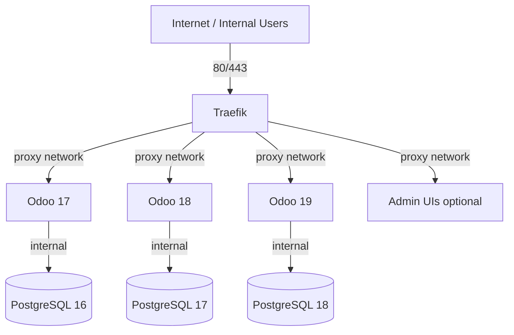
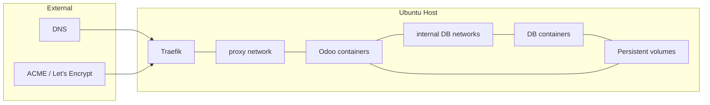
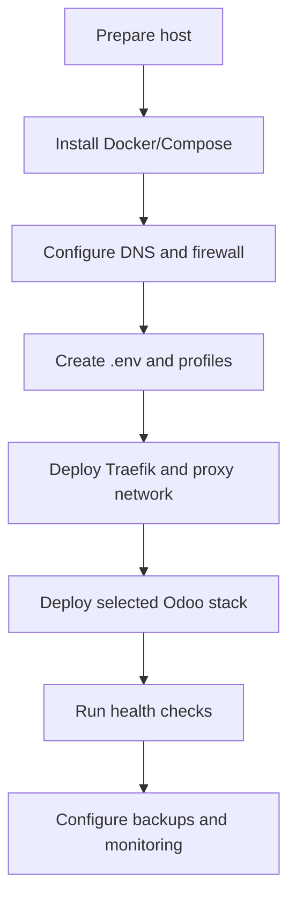

# Architecture Guide - Odoo Infrastructure Manager

## 1. Document Overview

| Field | Value |
|---|---|
| Target OS | Ubuntu Server 22.04 LTS / 24.04 LTS |
| Components | Traefik, Docker / Docker Compose, PostgreSQL, Odoo 17/18/19, optional pgAdmin/Portainer |
| Audience | Infrastructure engineers, DevOps engineers, system administrators |

## 2. Quick Information Table

| Item | Details |
|---|---|
| Orchestration | Python manager (`app/`), shell scripts, Ansible, Jenkins (variant-dependent) |
| Reverse proxy | Traefik (TLS termination, routing, middleware) |
| Data isolation | Separate PostgreSQL instances/networks per Odoo stack (as designed per variant) |
| Secrets | `.env` / vault mechanisms (never committed) |

## 3. Table of Contents

1. [Document Overview](#1-document-overview)
2. [Quick Information Table](#2-quick-information-table)
3. [Table of Contents](#3-table-of-contents)
4. [Architecture Diagram](#4-architecture-diagram)
5. [Prerequisites Table](#5-prerequisites-table)
6. [Required Ports Table](#6-required-ports-table)
7. [Installation Workflow](#7-installation-workflow)
8. [Step-by-Step Installation](#8-step-by-step-installation)
9. [Configuration Files](#9-configuration-files)
10. [Directory Structure](#10-directory-structure)
11. [Service Management Commands](#11-service-management-commands)
12. [Verification Commands](#12-verification-commands)
13. [Troubleshooting Table](#13-troubleshooting-table)
14. [Backup and Restore Commands](#14-backup-and-restore-commands)
15. [Security Checklist](#15-security-checklist)
16. [Official References](#16-official-references)

## 4. Architecture Diagram





## 5. Prerequisites Table

| Component | Purpose | Verification |
|---|---|---|
| Ubuntu LTS | Host OS | `lsb_release -a` |
| Docker + Compose v2 | Container runtime | `docker info && docker compose version` |
| DNS records | Domain routing to Traefik | `dig +short <domain>` |
| Firewall rules | Allow 80/443 as required | `sudo ufw status` |

## 6. Required Ports Table

| Port | Protocol | Purpose | Exposure |
|---:|---|---|---|
| 80 | TCP | HTTP / ACME challenge / redirect | Public (design-dependent) |
| 443 | TCP | HTTPS | Public (design-dependent) |
| 8069 | TCP | Odoo HTTP | Internal/routed |
| 8072 | TCP | Odoo longpolling/websocket | Internal/routed |
| 5432 | TCP | PostgreSQL | Internal only |

## 7. Installation Workflow



## 8. Step-by-Step Installation

### 8.1 Prepare the Host

**Purpose:** Ensure the Ubuntu host meets baseline requirements.

**Commands:**

```bash
sudo apt update
sudo apt -y upgrade
```

**Verification:**

```bash
uname -a
docker --version || true
```

**Expected Result:** Host packages are current; Docker availability is known.

### 8.2 Configure Network and DNS

**Purpose:** Route public domains to the Traefik entrypoint.

**Commands:**

```bash
# Configure DNS A/AAAA records at your DNS provider (no local command changes DNS globally)
# Open firewall ports as required
sudo ufw allow 80/tcp
sudo ufw allow 443/tcp
```

**Verification:**

```bash
sudo ufw status verbose
```

**Expected Result:** Required ports are allowed; DNS resolves to the host IP.

### 8.3 Deploy Reverse Proxy and Application Stacks

**Purpose:** Start Traefik and selected Odoo/PostgreSQL services.

**Commands:**

```bash
# Use the deployment method for your variant (CLI, scripts, compose, or Ansible)
python3 app/main.py --action traefik
python3 app/main.py --action odoo17
```

**Verification:**

```bash
docker ps
python3 app/main.py --action health
```

**Expected Result:** Traefik and selected stacks are running and pass health checks.

## 9. Configuration Files

| Path/Pattern | Purpose |
|---|---|
| `.env` | Secrets and environment settings |
| `profiles/*.yaml` | Profile-driven parameters |
| `deployment/*/` | Compose, Ansible, and scripts per variant |
| `templates/*.j2` | Renderable configuration templates |

## 10. Directory Structure

| Path | Description |
|---|---|
| `app/` | Manager application |
| `automation/` | Automation scripts and Ansible assets |
| `deployment/` | Deployment bundles |
| `docs/` | Technical documentation |
| `tests/` | Test suites |

## 11. Service Management Commands

| Task | Command | Verification |
|---|---|---|
| View containers | `docker ps -a` | Status reviewed |
| View logs | `docker logs <container> --tail 100` | Errors identified |
| Restart service | `docker restart <container>` | Service returns healthy |

## 12. Verification Commands

| Check | Command | Expected Result |
|---|---|---|
| Traefik routing | `curl -Ik https://<domain>` | TLS/HTTP response |
| Odoo login page | `curl -I http(s)://<host>/web/login` | 200/303 depending on state |
| DB readiness | `docker exec <db> pg_isready -U <user> -d <db>` | accepting connections |

## 13. Troubleshooting Table

| No. | Problem | Possible Cause | Solution | Verification |
|---:|---|---|---|---|
| 01 | 404/502 via domain | Router labels, backend, or DNS issue | Check Traefik routers/services and DNS | Traefik dashboard/logs + curl |
| 02 | Certificate not issued | ACME challenge blocked | Open 80/443, verify DNS, check ACME email/config | ACME logs |
| 03 | Odoo DB errors | Wrong env vars or network | Validate DB host/user/password and networks | `pg_isready`, container logs |

## 14. Backup and Restore Commands

| Operation | Command (example) | Verification |
|---|---|---|
| Backup DB | `bash automation/scripts/backup-db.sh <ver> <db> <retention>` | Artifacts + checksums |
| Restore DB | `bash automation/scripts/restore-db.sh <ver> <dump.sql.gz> <db> --force` | Application and data validated |

## 15. Security Checklist

| Control | Verification |
|---|---|
| DB not exposed publicly | Port bindings/firewall review |
| Secrets protected | `.env` permissions and access controls |
| TLS enforced | HTTPS responses and redirect policy |
| Least privilege containers | Security options and mounts reviewed |

## 16. Official References

| Resource | URL |
|---|---|
| Traefik | https://doc.traefik.io/traefik/ |
| Docker | https://docs.docker.com/ |
| Odoo | https://www.odoo.com/documentation/ |
| PostgreSQL | https://www.postgresql.org/docs/ |
