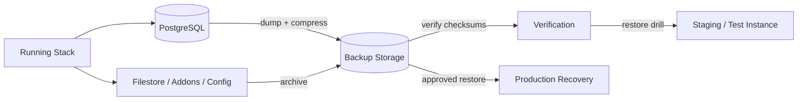
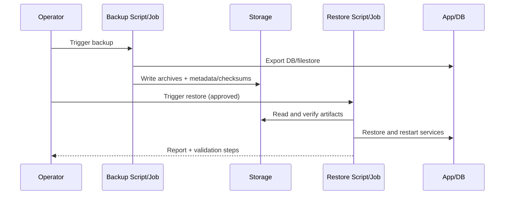
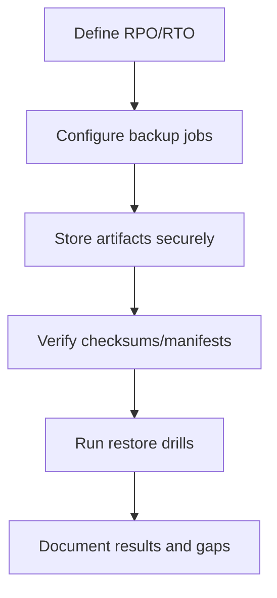

# Disaster Recovery and Backup Runbook

## 1. Document Overview

| Field | Value |
|---|---|
| Target OS | Ubuntu Server 22.04 LTS / 24.04 LTS |
| Scope | PostgreSQL dumps, filestore/addons/config backups, restore procedures, DR drills |
| Audience | System administrators, DevOps/on-call engineers |

## 2. Quick Information Table

| Item | Details |
|---|---|
| Backup types | Logical DB dumps, filestore archives, config/addons archives, metadata/checksums (variant-dependent) |
| Restore modes | Restore to existing instance or restore as new/test instance (where supported) |
| Safety rule | Never overwrite production data before verifying backup integrity and taking a safety snapshot |

## 3. Table of Contents

1. [Document Overview](#1-document-overview)
2. [Quick Information Table](#2-quick-information-table)
3. [Table of Contents](#3-table-of-contents)
4. [Architecture Diagram](#4-architecture-diagram)
5. [Prerequisites Table](#5-prerequisites-table)
6. [Required Ports Table](#6-required-ports-table)
7. [Installation Workflow](#7-installation-workflow)
8. [Step-by-Step Installation](#8-step-by-step-installation)
9. [Configuration Files](#9-configuration-files)
10. [Directory Structure](#10-directory-structure)
11. [Service Management Commands](#11-service-management-commands)
12. [Verification Commands](#12-verification-commands)
13. [Troubleshooting Table](#13-troubleshooting-table)
14. [Backup and Restore Commands](#14-backup-and-restore-commands)
15. [Security Checklist](#15-security-checklist)
16. [Official References](#16-official-references)

## 4. Architecture Diagram





## 5. Prerequisites Table

| Requirement | Purpose | Verification |
|---|---|---|
| Sufficient disk space | Store dumps/archives and temp restore files | `df -h` |
| Access to DB/container runtime | Run dump/restore commands | `docker ps` |
| Known DB/user/container names | Correct targeting | Deployment config review |
| Tested restore credentials/process | Reduce recovery risk | Prior DR drill record |

## 6. Required Ports Table

| Port | Relevance | Note |
|---:|---|---|
| 5432 | PostgreSQL (internal) | Restore typically runs inside network/container context; do not expose publicly |
| 80/443 | Service validation after restore | Used to verify web/TLS availability |

## 7. Installation Workflow



## 8. Step-by-Step Installation

### 8.1 Configure Backup Storage and Permissions

**Purpose:** Ensure backups can be written and protected.

**Commands:**

```bash
sudo mkdir -p /data/backups
sudo chown "$(id -u)":"$(id -g)" /data/backups || true
```

**Verification:**

```bash
ls -ld /data/backups
df -h /data/backups
```

**Expected Result:** Backup directory exists and has sufficient space.

### 8.2 Run a Manual Backup (Variant-Dependent)

**Purpose:** Produce a recoverable backup set.

**Commands:**

```bash
# Automation example (adjust args to your environment)
bash automation/scripts/backup-db.sh 17 odoo17_prod 7

# Deployment-variant example (adjust args/script path)
# bash deployment/<variant>/scripts/backup.sh instance1 /data/backups/odoo17
```

**Verification:**

```bash
ls -lah <backup_directory>
# Verify checksum/metadata files if produced by your workflow
```

**Expected Result:** Backup artifacts and metadata are created successfully.

### 8.3 Verify Backup Integrity

**Purpose:** Confirm artifacts are readable before a restore is needed.

**Commands:**

```bash
# Example patterns; use the exact checksums/manifests produced by your variant
sha256sum <backup_file> || shasum -a 256 <backup_file>
gzip -t <dump_file.sql.gz>
```

**Verification:**

```bash
echo $?
```

**Expected Result:** Checksum and compression tests pass.

### 8.4 Perform a Controlled Restore Drill

**Purpose:** Validate recovery steps without risking production.

**Commands:**

```bash
# Restore to a test database/instance where supported
bash automation/scripts/restore-db.sh 17 <dump_file.sql.gz> <test_db_name> --force
```

**Verification:**

```bash
docker exec <db_container> pg_isready -U <user> -d <test_db_name>
# Perform application-level login/data checks on the test instance
```

**Expected Result:** Test restore completes and data is usable.

## 9. Configuration Files

| File/Location | Purpose |
|---|---|
| `.env` | Database credentials and runtime variables (protect strictly) |
| `automation/scripts/backup-db.sh` / `restore-db.sh` | Automation backup/restore logic |
| `deployment/*/scripts/*backup*` / `*restore*` | Variant-specific backup/restore logic |
| Backup manifests/checksum files | Integrity and restore metadata (if generated) |

## 10. Directory Structure

| Path (example) | Description |
|---|---|
| `/data/backups/odoo17/` | Odoo 17 backup artifacts (if configured) |
| `/data/backups/odoo18/` | Odoo 18 backup artifacts (if configured) |
| `/data/backups/odoo19/` | Odoo 19 backup artifacts (if configured) |
| `backups/` (repo-local) | Local snapshots/archives (review sensitivity) |

## 11. Service Management Commands

| Task | Command | Verification |
|---|---|---|
| Check DB container | `docker ps --filter name=<db>` | Container running |
| Check app container | `docker ps --filter name=<odoo>` | Container running |
| Review restore logs | `docker logs <container> --tail 200` | Errors identified |

## 12. Verification Commands

| Check | Command | Expected Result |
|---|---|---|
| DB readiness | `docker exec <db_container> pg_isready -U <user> -d <db>` | accepting connections |
| Archive integrity | `gzip -t <dump.sql.gz>` | exit 0 |
| Web login (post-restore) | `curl -I http(s)://<host>/web/login` | Expected HTTP response |

## 13. Troubleshooting Table

| No. | Problem | Possible Cause | Solution | Verification |
|---:|---|---|---|---|
| 01 | Backup file missing | Wrong path, permissions, or failed dump | Check script args/logs and disk space | Artifact exists and non-empty |
| 02 | Restore fails on SQL import | Corrupt dump, version mismatch, wrong DB/user | Verify checksum; confirm compatibility; retry on test DB | `pg_isready` + app checks |
| 03 | Filestore mismatch | Wrong archive path or partial restore | Validate manifest/checksums and restore order | Attachments/files load correctly |
| 04 | Service down after restore | Config/env mismatch or startup error | Inspect logs/env; restart in controlled order | Containers healthy; HTTP OK |

## 14. Backup and Restore Commands

| Operation | Command (examples) | Verification |
|---|---|---|
| Backup (automation) | `bash automation/scripts/backup-db.sh <version> <db_name> <retention>` | Files + checksums/metadata |
| Restore (automation) | `bash automation/scripts/restore-db.sh <version> <dump.sql.gz> <db_name> --force` | DB + app validation |
| Stop/start around maintenance | `docker compose -f <file> stop <service>` / `up -d <service>` | Controlled service state |

> [!WARNING]
> Restore operations can overwrite data. Require explicit approval, verify artifacts, and keep a safety backup before destructive steps.

## 15. Security Checklist

| No. | Control | Verification |
|---:|---|---|
| 01 | Backup storage access restricted | Permissions and IAM/storage policy |
| 02 | Secrets excluded or protected in archives | Archive content review policy |
| 03 | Off-host/encrypted backup copy (recommended) | Backup inventory record |
| 04 | Restore drills performed periodically | DR drill log |

## 16. Official References

| Resource | URL |
|---|---|
| PostgreSQL Backup and Restore | https://www.postgresql.org/docs/current/backup.html |
| Docker Volumes/Backups | https://docs.docker.com/storage/volumes/ |
| Odoo Deployment/Operations | https://www.odoo.com/documentation/ |
| NIST Contingency Planning (general) | https://csrc.nist.gov/publications/sp |

---
*Confirm script arguments, manifest formats, and container names for the exact deployment variant before use.*