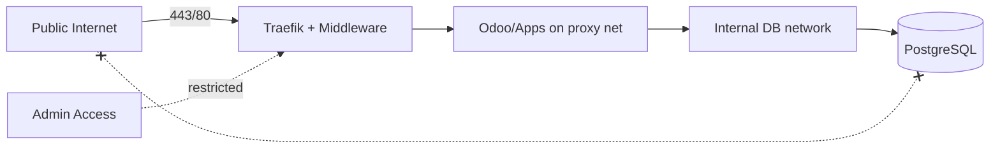
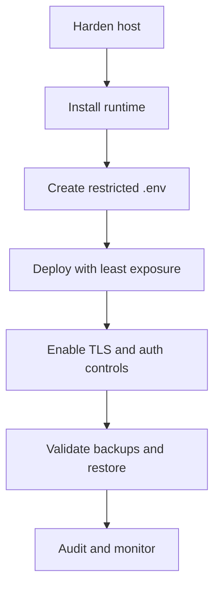

# Security and Hardening Guide

## 1. Document Overview

| Field | Value |
|---|---|
| Target OS | Ubuntu Server 22.04 LTS / 24.04 LTS |
| Scope | Secrets, container/network isolation, TLS, operational safeguards |
| Audience | Security reviewers, DevOps, system administrators |

## 2. Quick Information Table

| Area | Control Summary |
|---|---|
| Secrets | Environment files/vaults; restricted permissions; no Git commits |
| Network | PostgreSQL internal-only; proxy network for routed services |
| TLS | Traefik-managed certificates (ACME) where configured |
| Execution | Non-interactive/scripted operations should avoid unsafe shell interpolation |

## 3. Table of Contents

1. [Document Overview](#1-document-overview)
2. [Quick Information Table](#2-quick-information-table)
3. [Table of Contents](#3-table-of-contents)
4. [Architecture Diagram](#4-architecture-diagram)
5. [Prerequisites Table](#5-prerequisites-table)
6. [Required Ports Table](#6-required-ports-table)
7. [Installation Workflow](#7-installation-workflow)
8. [Step-by-Step Installation](#8-step-by-step-installation)
9. [Configuration Files](#9-configuration-files)
10. [Directory Structure](#10-directory-structure)
11. [Service Management Commands](#11-service-management-commands)
12. [Verification Commands](#12-verification-commands)
13. [Troubleshooting Table](#13-troubleshooting-table)
14. [Backup and Restore Commands](#14-backup-and-restore-commands)
15. [Security Checklist](#15-security-checklist)
16. [Official References](#16-official-references)

## 4. Architecture Diagram



## 5. Prerequisites Table

| Control | Requirement | Verification |
|---|---|---|
| OS hardening baseline | Updated packages, SSH controls | `sudo apt update`, SSH config review |
| Docker security | Trusted images, controlled daemon access | `docker info` |
| Firewall | Minimal exposed ports | `sudo ufw status` |

## 6. Required Ports Table

| Port | Exposure | Security Note |
|---:|---|---|
| 22 | Restricted | Use keys, limit sources, disable password auth where appropriate |
| 80 | Controlled | Needed for HTTP/ACME in common setups |
| 443 | Controlled | Primary public TLS entry |
| 5432 | Internal only | Never expose to public networks |

## 7. Installation Workflow



## 8. Step-by-Step Installation

### 8.1 Protect Secrets

**Purpose:** Prevent credential leakage.

**Commands:**

```bash
cp templates/env.template .env
chmod 600 .env
```

**Verification:**

```bash
stat -c "%a %n" .env
```

**Expected Result:** `.env` is readable/writable only by the owner.

### 8.2 Restrict Network Exposure

**Purpose:** Keep databases and admin interfaces non-public by default.

**Commands:**

```bash
sudo ufw allow OpenSSH
sudo ufw allow 80/tcp
sudo ufw allow 443/tcp
sudo ufw --force enable
```

**Verification:**

```bash
sudo ufw status verbose
ss -tulpn
```

**Expected Result:** Only intended ports are listening publicly.

### 8.3 Apply Container and Proxy Controls

**Purpose:** Reduce blast radius and enforce secure routing.

**Commands:**

```bash
# Review compose/security options in your deployment variant before applying
docker compose -f <compose_file> config
```

**Verification:**

```bash
# Confirm no public DB bindings and TLS/middleware settings in rendered config
docker compose -f <compose_file> config | sed -n '1,200p'
```

**Expected Result:** Security options, networks, and bindings match policy.

## 9. Configuration Files

| File | Security Focus |
|---|---|
| `.env` | Secrets, passwords, tokens, ACME email |
| Traefik static/dynamic config | TLS, dashboard auth, middlewares |
| Compose files | Port bindings, networks, security options, volumes |
| Ansible inventory/vars | Privileged access handling and secret storage |

## 10. Directory Structure

| Path | Security Note |
|---|---|
| `templates/` | Source templates; review before rendering |
| `deployment/*/` | Variant-specific security posture; do not assume uniformity |
| `docs/` | Operational guidance; keep aligned with actual configs |

## 11. Service Management Commands

| Task | Command | Verification |
|---|---|---|
| Inspect listeners | `ss -tulpn` | No unintended public services |
| Inspect container config | `docker inspect <container>` | Networks/mounts/env reviewed carefully |
| Rotate/reload via compose | `docker compose -f <file> up -d` | Updated config applied |

## 12. Verification Commands

| Check | Command | Expected Result |
|---|---|---|
| TLS certificate | `curl -Iv https://<domain>` | Valid certificate chain presented |
| No public PostgreSQL | `ss -tulpn \| grep :5432` | Not bound to `0.0.0.0` (or absent on host) |
| Secret file perms | `stat -c "%a %n" .env` | `600` or stricter policy |

## 13. Troubleshooting Table

| No. | Problem | Possible Cause | Solution | Verification |
|---:|---|---|---|---|
| 01 | Dashboard exposed | Missing auth middleware/route controls | Restrict router, add auth, remove insecure flags | External access test |
| 02 | Secret leak risk | Broad file perms or committed env | Restrict perms, rotate secrets, purge from history if needed | Repo and host audit |
| 03 | Weak container isolation | Shared host mounts/privileged mode | Apply least privilege and minimal mounts | `docker inspect` |

## 14. Backup and Restore Commands

| Operation | Security Consideration | Verification |
|---|---|---|
| Backup creation | Protect archives and checksums; encrypt off-host copies | Access controls + integrity checks |
| Restore | Verify checksums/signatures before applying to production | Restore drill in staging |

## 15. Security Checklist

| No. | Item | Status | Evidence |
|---:|---|---|---|
| 01 | `.env` not in Git and has `600` perms | ☐ | `git ls-files .env` empty; `stat` output |
| 02 | PostgreSQL internal-only | ☐ | Compose + `ss` output |
| 03 | TLS enabled and redirects configured | ☐ | `curl -I http://` / `curl -Ik https://` |
| 04 | Admin dashboards protected | ☐ | Auth challenge / access policy |
| 05 | No default production passwords | ☐ | Secret review/rotation record |
| 06 | Backups tested and protected | ☐ | Restore drill log |

## 16. Official References

| Resource | URL |
|---|---|
| Docker security | https://docs.docker.com/engine/security/ |
| Traefik security/middlewares | https://doc.traefik.io/traefik/middlewares/overview/ |
| OWASP Cheat Sheets | https://cheatsheetseries.owasp.org/ |
| CIS Benchmarks (general) | https://www.cisecurity.org/cis-benchmarks |
