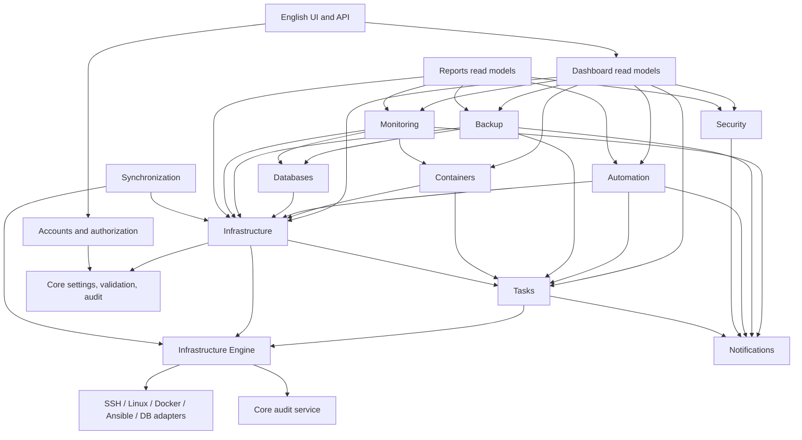

# Infrastructure Manager: Functional Architecture

**Status:** implementation blueprint based on the repository inspected on 2026-11-03.  
**UI language:** English only (the active product requirement).  
**Architecture rule:** business modules own their records; shared execution, audit, identity, and event services coordinate work without duplicating those records.

## 1. Current-state assessment

The repository is already a modular Django project, but its completeness varies by area. `apps/infrastructure` owns managed hosts and services and contains older CLI/workflow code. `infrastructure_engine` now has a strict SSH probe adapter and typed operation gateway for server connection verification; the broader Linux/Docker/Ansible dispatch and durable task processing are still pending. Several old infrastructure services remain mirrored under `apps/infrastructure`. The web dashboard currently has working inventory, Docker read-only discovery, service catalog, database catalog, backups, alerts, audit, Traefik inspection, and Semaphore-approved task launches. Docker mutations, general Ansible playbook authoring, remote Linux administration, centralized durable task scheduling, notifications, and reports are not yet complete. Presence of a package directory alone does not mean a capability is operational.

The core data sources currently include `ManagedHost`, `ManagedService`, `DatabaseInstance`, `DjangoProject`, `ApprovedTaskTemplate`, `AutomationRun`, `BackupPolicy`, `BackupArtifact`, `ResourceSample`, `AlertRule`, `AlertEvent`, and `AuditLog`. Dashboard totals and pages must continue querying those source records rather than creating parallel copies. The application's own SQLite database is separate from external database inventory.

## 2. Target layers and boundaries

| Layer | Responsibility | Target location |
| --- | --- | --- |
| Presentation | English UI, forms, accessibility, API serializers | `templates/`, `static/`, app `views/` and `serializers/` |
| Application | Use cases, transactions, permission checks, coordination | module `services/` |
| Business logic | Module rules and state transitions | owning Django app |
| Selectors / data access | Read queries and aggregate projections | module `selectors/`; repositories only for justified adapters or complex persistence |
| Infrastructure Engine | Validate and coordinate infrastructure requests | `infrastructure_engine/core/`, `executors/`, `security/` |
| Adapter | Vendor and protocol boundary (SSH, Docker, Ansible, DB, systemd) | `infrastructure_engine/adapters/<provider>/` |
| Execution | Durable task state, queue dispatch, output, retry/cancel policy | dedicated `apps/tasks/` (planned) using an asynchronous worker |
| Storage | Relational business records; bounded metric retention | Django ORM; SQLite for local use, PostgreSQL for production, time-series backend later if scale requires |

Dependencies point inward toward shared contracts. Core must not import business apps. The dashboard may call module selectors/services but does not own their data. All mutating infrastructure actions must pass through an application service and the Infrastructure Engine; request handlers must never execute arbitrary shell strings or talk directly to Docker/SSH.

## 3. Module responsibilities and source of truth

| Module | Owns | Depends on | Current status |
| --- | --- | --- | --- |
| Core | Settings, health aggregation, audit records, shared validation/errors | Accounts identity contract; adapters only through health checks | Partial; allowlisted operational defaults page and shared audit service; broader health aggregation pending |
| Accounts | Users, groups, roles, effective permission decisions, sessions | Core | Partial; additive grants, delegation validation, dotted/legacy codes, and inactive-account denial are implemented; complete admin workflows pending |
| Security | Encrypted credential references, access policy and security events | Accounts, Core audit | Partial; Fernet vault, fallback-key rotation command, metadata-only UI, enable/disable and strict SSH host-key handling implemented; broader security center pending |
| Infrastructure | Server registry, groups, connection profile references, host/service inventory | Accounts, Core, Engine | Partial; server groups, OS/connection metadata and granular registry permissions; deep Linux inventory and safe operations pending |
| SSH Connection Manager | Host-key-verified SSH probes and discovered OS metadata | Infrastructure, Security, Engine | Partial; verified read-only `uname -srm` probe is operational when a trusted host key and encrypted SSH credential are configured; discovery coverage/scheduling pending |
| Infrastructure Engine | Typed operation registry, validation, policy and adapter dispatch | Accounts, Infrastructure, Security | Partial; `server.test_connection` is registered; all mutations are deliberately disabled until Task Manager exists |
| Dashboard | Read-only cross-module overview and navigation | module selectors, Monitoring, Tasks, Backup, Security | Partial; real data where connected; show unavailable state elsewhere |
| Containers | Docker engine inventory, containers/images/volumes/networks/compose references | Infrastructure, Engine, Tasks, Audit | Package scaffold and safe read-only discovery; mutations pending |
| Automation | Ansible inventories, approved playbooks/templates, schedules, executions | Infrastructure, Accounts, Engine, Tasks, Monitoring | Semaphore approved templates/runs exist; general inventory/playbook management pending |
| Monitoring | Targets, samples, rules, alert events and acknowledgement | Infrastructure, Containers, Databases, Notifications | Partial; samples/rules/events exist; scheduling and retention policy pending |
| Backup | Policies, schedules, artifacts, restore records and verification | Infrastructure, Databases, Containers, Tasks, Notifications | Partial; policy/artifact records exist; execution/scheduling/restore engine pending |
| Databases | External database instances and safe provider operations | Infrastructure, Security credentials, Backup, Monitoring, Engine | Partial; catalog exists; connection adapters/health pending |
| Tasks | Shared long-running operation lifecycle, logs, retry/cancel metadata | Accounts, Core audit, Engine | Planned; existing `AutomationRun` remains automation-owned until migration can preserve history |
| Notifications | In-app/email delivery records and preferences | Monitoring, Backup, Automation, Tasks, Security | Scaffold only |
| Reports | Read models and CSV/PDF export | source module selectors | Scaffold only |
| Synchronization | Remote inventory/metadata collection state and conflict records | Infrastructure, Engine, Core | Partial; sync primitives exist, remote fleet workflows pending |

## 4. Dependency map

## 5. Canonical relationships

- `User` owns authentication. Roles and groups contribute permission codes; direct user grants are additive. User and profile deactivation deny access even if grants remain.
- `ManagedHost` is the canonical managed server. Server groups, SSH credential references, connection details, and collected host metadata attach to it; secret material does not.
- `ManagedService`, `DatabaseInstance`, and future Docker engine records reference a host. Dashboard views project these records; they do not copy them.
- Automation inventories reference hosts where possible. Approved playbooks reference inventories/hosts and each execution references its source template and a shared task.
- Monitoring targets refer to source objects by explicit foreign key or typed target contract. Samples are time-bounded telemetry, not current-state business records. Alert events reference their rule and target.
- Backup policies create backup jobs; artifacts reference source, destination, policy, and verification result. Restore is a separate task and audit event.
- Shared tasks point to source module and source record using a typed origin (`source_app`, `source_model`, `source_pk`) and store execution metadata/logs only.
- Audit logs reference actor, operation, module, target, request IP, result, and task reference. Secret values and raw credentials are excluded.
- Notifications reference their originating event/task and recipient; reports query source selectors and do not persist duplicate operational records.

Use `PROTECT` for records whose deletion would invalidate operational history, `SET_NULL` for optional actors, and `CASCADE` only for owned child data whose history is intentionally removed with its parent. Add indexes for status/time, host/time, and task/source lookups. Use UUID identifiers for externally addressable task/event records; retain current integer IDs during a compatibility period.

## 6. Permission model

Permission codes follow `<resource>.<action>` for new authorization contracts, for example `server.view`, `server.create`, `server.update`, `server.restart`, `docker.container.start`, `automation.playbook.execute`, and `backup.restore`. Existing underscore codes remain accepted as aliases until all callers migrate. Permission evaluation is additive across direct user grants, assigned system role, application groups, and Django auth groups. Superusers bypass the catalog; inactive accounts and inactive profiles never receive effective grants. Server scope and operation scope are enforced by the module service, not only by hidden UI links. Privileged operations require explicit confirmation/approval policy and audit evidence.

## 7. API contract

Versioned APIs live under `/api/v1/`. Keep the existing compatibility routes during migration. Every endpoint validates input, requires authentication, checks resource/action and target scope, paginates collections, and returns the common `{success, message, data, errors}` envelope. Infrastructure operation endpoints create a task and return its identifier; they do not hold a web request open for long-running execution. OpenAPI documentation is generated from serializers and explicit schemas. Never expose credentials, private keys, bearer tokens, or unredacted execution output.

## 8. End-to-end workflow contracts

### Register server
Validate and normalize host input -> authorize `server.create` -> resolve credential reference -> create a pending connection task -> test through SSH/Ansible adapter -> save connection result -> initialize collection targets -> emit audit event -> expose the same host to inventory/automation/monitoring. Failed connection tests remain visible and do not claim the host is online.

### Infrastructure operation (including container restart)
Authorize user and target scope -> validate state and policy -> require confirmation for disruptive action -> create task and audit request -> dispatch a typed adapter operation with structured arguments -> capture redacted output -> verify resulting state -> update task and monitoring projection -> emit event/notification. No arbitrary shell command endpoint.

### Ansible execution
Resolve approved playbook/inventory and host scope -> validate variables against schema -> authorize execution -> create task -> invoke Ansible adapter with restricted arguments -> stream/persist bounded output -> finalize history/task -> create alert/notification on policy-defined failure.

### Backup and restore
Validate policy/source/destination/capacity -> create task -> execute backup adapter -> checksum/integrity verification -> persist artifact -> apply retention transactionally -> notify. Restore has a separate permission, target validation, preview, explicit confirmation, task, and post-restore verification.

### Monitoring
Scheduled collector obtains a scoped target batch -> adapter returns typed measurements -> validate units/timestamps -> persist within configured retention -> evaluate enabled rules -> create/dedupe alert event -> notify -> dashboard reads aggregates from monitoring selectors.

## 9. Phased delivery and acceptance gates

1. **Core + Accounts + Security:** permission resolution, active-account enforcement, encrypted credentials, audit contract and security events. Gate: permission/delegation matrix, inactive-account checks, key rotation procedure and no-secret disclosure tests.
2. **Dashboard + Global Settings:** source-backed projections, validated settings and truthful provider status. Gate: every metric traces to its owner; unavailable providers never produce invented values.
3. **Infrastructure Server Registry:** server groups, canonical hosts, connection metadata and credential references. Gate: migration preserves current hosts and local/remote types are validated.
4. **SSH Connection Manager:** host-key verification, protected credentials, bounded probes, connection history and metadata refresh. Gate: success, bad host key, auth failure, timeout and disabled credential tests.
5. **Infrastructure Engine:** typed operation contracts, adapter dispatch, policy validation, dry-run where meaningful and structured results. Gate: no arbitrary shell entry point; every mutation is authorized, validated and audited.
6. **Task Manager:** shared task state, bounded/redacted output, queue/worker, timeout, cancellation, retry and source references. Gate: terminal-state rules, duplicate dispatch protection and adapter failure recovery.
7. **Linux System Management:** service/process/storage/network/user read models, then authorized operations through the engine. Gate: mock adapter coverage and confirmation/audit for disruptive operations.
8. **Docker Management:** engine/container/image/volume/network/compose capabilities; mutations only through tasks and the engine. Gate: mocked adapter, target scoping and action-specific permissions.
9. **Ansible Automation:** inventories, approved playbooks/variables, scheduling and execution history through the task engine. Keep Semaphore as an adapter during transition. Gate: no policy bypass and redacted output.
10. **Monitoring + Alerts:** target registry, collection, retention, rule evaluation and alert lifecycle. Gate: failures remain visible and alert deduplication is deterministic.
11. **Backup & Recovery:** policy execution, destinations, verification, retention and safe restore. Gate: mocked end-to-end restore and separate approval/audit.
12. **Database Management:** external providers remain separate from the platform database; begin with read-only discovery. Gate: masking, provider isolation and safe backup/restore handoff.
13. **Notifications + Reports:** event delivery/preferences and source-backed exports. Gate: deduplication, access control, export correctness and auditability.
14. **Remote Server Synchronization:** remote inventory/metadata, health history, retry/backoff and conflict recovery. Gate: idempotent sync, per-server authorization and offline behavior.

Each gate must be satisfied before destructive actions are enabled. Integrations remain explicitly “not configured” until a live provider has been verified.

## 10. Feature implementation ledger

| Capability | Status | Evidence / requirement to enable |
| --- | --- | --- |
| English-only enterprise shell and dashboard | Implemented, tested | `templates/base/base.html`, `static/css/enterprise-shell.css`; restart the web process and serve static assets |
| Account/role/group permission resolution | Implemented, tested | `apps/accounts/services/permission_service.py`; direct, role, app-group and Django-group grants are additive; assignment API validates catalog and actor grant scope |
| Credential encryption and rotation | Implemented, tested | `apps/security/services/credentials.py`, `rotate_credential_keys`; configure and back up Fernet key material |
| Server registry and groups | Partial, tested | `ManagedHost`, `ServerGroup`; hardware discovery and server-detail sections remain pending |
| SSH connection test | Partial, tested with mocked SSH | Needs remote host-key entry in the system user's known-hosts file, active SSH credential, network access and least-privilege remote account |
| Infrastructure operation execution | Partial | Only the registered, read-only server connection probe is enabled; mutations return unavailable until persistent tasks and worker isolation exist |
| Global operational settings | Partial, tested | Four validated defaults stored in `SystemSetting`; configured environment variables override and make fields read-only |
| Docker | Partial/read-only | Docker SDK read discovery must be explicitly configured; lifecycle writes are not enabled before engine/task gates |
| Ansible | Partial/approved-template adapter | Semaphore URL/token and reviewed templates required; general inventory/playbook authoring is pending |
| Monitoring | Partial | Prometheus/local providers are configuration-dependent; scheduled collectors and retention cleanup are pending |
| Backup, databases, notifications, reports, Linux administration, synchronization | Partial or scaffold | Module records/routes exist in parts; end-to-end operational workflows remain pending |

The ledger describes tested implementation state rather than package presence. Update each row only when the feature's integration path, permission checks, failure behavior, audit record and UI have been verified together.

## 11. Immediate implementation sequence

1. Harden effective permissions, validate delegated grants, and preserve legacy permission-code callers.
2. Complete credential vault, server registry and host-key-verified SSH connection handling.
3. Implement the typed Infrastructure Engine before shared task processing; route all new mutations through both.
4. Implement remaining modules in the fourteen phases above, preserving existing records and APIs through adapters and migrations.
